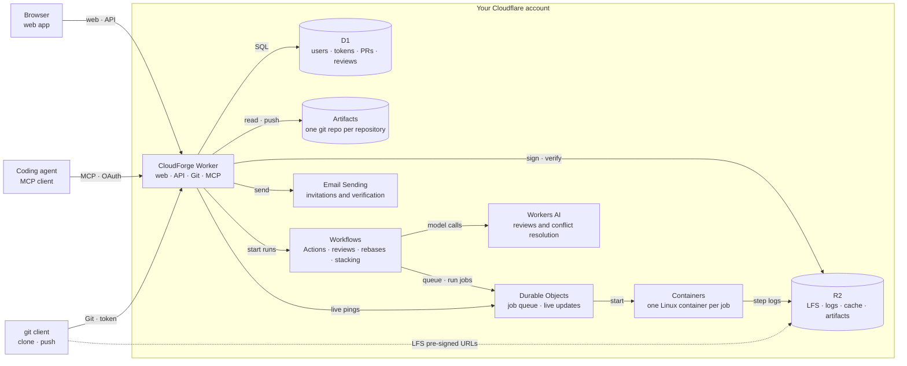

<!-- Modified by CyberNova for the CloudForge fork (forked 2026-10-22). Originally Apache-2.0 (see LICENSES/Apache-2.0.txt). -->

[简体中文](README.md) | **English**

<p align="center">
  
</p>

<p align="center">
  <a href="https://cnb.cool/CyberNova2333/cloudforge/-/build/logs"></a>
  <a href="LICENSE"></a>
  <a href="https://workers.cloudflare.com/"></a>
</p>

<h1 align="center">CloudForge</h1>

CloudForge is a code host deployed in your own Cloudflare account, bringing Git repositories, pull requests (PRs), CI, and AI review into one application. It supports teams of people and coding agents: agents submit code and address checks and review feedback, while people use the review inbox to decide questions that need human judgment.

> **Fork notice:** This is an independent fork of [choyiny/gitorange](https://github.com/choyiny/gitorange), based on `b3d5b08` on 2026-10-22 (see [.fork-base](.fork-base)). It is not affiliated with or endorsed by the upstream author.
>
> Original portions © 2026 GitOrange contributors, under [Apache-2.0](LICENSES/Apache-2.0.txt). Modifications © 2026 CyberNova; the combined work is distributed under [GPL-3.0-or-later](LICENSE). "GitOrange" and its logo remain the upstream project's marks and are not used here as product marks.

## Features

- **Code hosting:** Git over HTTPS, personal access tokens, Git LFS, branches and tags, file browsing, diffs, PR comments, and releases. Personal repositories support private, internal, and public visibility. Team repositories are visible to instance members; public repositories allow anonymous reads.
- **AI reviewers:** Presets cover security, data, performance, features, reliability, privacy, and shipping. Each agent maintains `AGENT.md` and `knowledge/` in its own repository and reviews repositories that invite it.
- **Human decisions:** Findings can be assigned to members with push access. Users can authorize AI to handle some findings per agent; human-confirmation findings from guarded agents, such as Security and Data, require individual reasons and cannot be delegated to AI.
- **Agent learning:** After a PR closes, dismissed change requests and teaching notes can become learning tasks that update an agent's instructions and knowledge files.
- **PR coordination:** Dependencies, conflicts, and interactions appear in lists, boards, and a relationship graph. The merge queue can be paused, and PR states explain whether an agent, a person, or another task needs to act next.
- **CI and run history:** CloudForge Actions executes supported GitHub Actions workflows in Cloudflare Containers, with logs, caches, artifacts, variables, and encrypted secrets. AI runs also record steps, model calls, and usage.
- **MCP access:** Coding agents authorize through OAuth at `/mcp` to read work, create PRs, inspect checks, and perform permitted operations. Tools are named `cloudforge_*`; the earlier `gitorange_*` names still work (they are not listed), so existing clients keep working.
- **Interface and administration:** Chinese and English UI, themes, live updates, global search, repository health, a review inbox, invitation-based registration, audit logs, and instance settings.

## How a PR moves through CloudForge

1. A person or coding agent pushes a branch and opens a PR through the web interface or MCP.
2. Matching Actions workflows run checks. Workflows using `cloudforge/relevance@v1` can select test modules according to their configuration.
3. Configured reviewer triggers start reviews, while the host analyzes relationships with other changes. Review modes include a single model call and `engine: pi` with read-only tools.
4. The PR page shows failed checks, change requests, findings requiring human judgment, and reasons for waiting.
5. A PR can merge after satisfying checks, review, dependencies, and pause rules. Inviting reviewer agents enables automatic merging, which can be disabled per PR; repositories without agents use human review and merging.
6. Merging uses rebase followed by fast-forward, with compare-and-swap (CAS) on the target ref to detect concurrent changes. Branch deletion follows repository settings; default, protected, and still-used branches are retained.

Rebasing preserves commit authors and messages but usually changes commit SHAs. After a server-side rebase, clients must fetch and reconcile their local history before pushing again. Review inputs, file counts, model context, and run time have limits, so AI review cannot be assumed to cover arbitrarily large PRs completely. Background work uses durable steps, state checks, and recovery to handle retries; external operations should still account for possible repeated execution.

See [reviewer agents, PR states, and automatic merging](docs/auto-merge.md) and [architecture](docs/architecture.md) for the detailed rules.

## Start from source

Running from source requires **Node.js 22.18 or later** and **Yarn**. Deployment also requires a Cloudflare account with access to the services used by the project, and Docker to build the Actions runner image. The installer checks required services and configuration. Email invitations require Email Sending; invitation links can also be used without email.

```bash
git clone https://cnb.cool/CyberNova2333/cloudforge.git
cd cloudforge
yarn install --frozen-lockfile
yarn wrangler login

# Inspect the installation plan without applying it
yarn cloudforge install --plan

# After reviewing the plan, create resources, migrate the database, and deploy
yarn cloudforge install
```

After installation, use the one-time setup code printed by the installer at `<BASE_URL>/setup` to create the first administrator. Then create repositories and invite members. To use AI review, create reviewer agents and invite them in each repository's settings.

```bash
# Inspect the installation status
yarn cloudforge status

# Continue an interrupted installation
yarn cloudforge install --resume
```

See [setup](docs/setup.md) for deployment details and [updating](docs/updating.md) for updates and adopting existing installations. Those guides also cover installation from a published package.

### Local development

```bash
cp wrangler.jsonc.example wrangler.jsonc
cp .dev.vars.example .dev.vars
# Set account, development environment, and local secrets as described in docs/development.md
yarn db:migrate:local
yarn dev
```

The default address is `http://localhost:8080`, shared by the web app, API, and Git endpoint. Development uses local D1 storage; Artifacts calls reach the real Cloudflare service. See [local development](docs/development.md) for demo data and Git LFS configuration.

### Checks and tests

```bash
yarn format:check
yarn typecheck
yarn test
```

`yarn test` runs the installer tests in Node.js, followed by Worker and pure frontend logic tests in workerd. The latter use a real local D1 database and an in-memory Artifacts test implementation. Test suite names, case names, and the default result summary are in Chinese; original assertions, third-party diagnostics, and stack traces are preserved.

CNB uses [.cnb.yml](.cnb.yml) to install dependencies, stage validation configuration, check formatting and types, build, and run all tests. GitHub and CloudForge instances use the configuration in [.github/workflows/](.github/workflows/).

## Actions compatibility

CloudForge reads `.github/workflows/` and implements a subset of GitHub Actions syntax. Check the features your workflow uses before migrating it. Current support includes:

- `push` and `pull_request` events with branch, tag, and path filters.
- Linux container `run` steps with `bash`, `sh`, `python`, and `node` scripts and working-directory settings.
- `actions/checkout`, `actions/setup-node`, `actions/cache`, artifact uploads and downloads, and JavaScript and composite actions from GitHub or the local repository.
- `needs`, conditional expressions, matrix expansion, environment variables, step and job outputs, `GITHUB_ENV`, `GITHUB_OUTPUT`, and `GITHUB_PATH`.
- Repository and instance variables and encrypted secrets, log masking, job concurrency limits, and queuing.

`ubuntu-latest` maps to a CloudForge Linux container size, not the complete GitHub-hosted runner image. `setup-node` uses the Node.js version in the runner image. Windows and macOS runners and GitHub-specific platform capabilities cannot be assumed to behave as they do on GitHub. See [skipping irrelevant tests](docs/ci-relevance.md) for relevance-check configuration.

## Architecture and costs



| Component                                    | Purpose                                                                                       |
| -------------------------------------------- | --------------------------------------------------------------------------------------------- |
| Cloudflare Workers                           | Same-origin web app, API, Git HTTPS, and MCP services                                         |
| Artifacts                                    | Git objects and refs, with one storage repository per CloudForge repository                   |
| D1                                           | Users, repository metadata, PRs, reviews, settings, and audit events                          |
| R2                                           | Git LFS, Actions logs, caches, and artifacts                                                  |
| Workflows, Durable Objects, Containers       | Durable orchestration, live connections, AI tasks, and CI execution                           |
| Workers AI, AI Gateway, Agents SDK, Computer | Model calls, usage records, and agent sandboxes; models are configurable in instance settings |
| Email Sending, Cron, Analytics API           | Email, scheduled cleanup and recovery, and usage reporting                                    |

Costs depend on enabled services, plans, and actual usage, rather than a fixed monthly total. Consult the official pricing when deploying: [Workers](https://developers.cloudflare.com/workers/platform/pricing/), [Artifacts](https://developers.cloudflare.com/artifacts/platform/pricing/), [Containers](https://developers.cloudflare.com/containers/pricing/), [Workers AI](https://developers.cloudflare.com/workers-ai/platform/pricing/), and [R2](https://developers.cloudflare.com/r2/pricing/). The application's usage and cost page provides estimates; Cloudflare's bill is authoritative.

## Documentation and contributing

[Setup](docs/setup.md) · [Updating](docs/updating.md) · [Configuration](docs/configuration.md) · [Architecture](docs/architecture.md) · [Local development](docs/development.md) · [Review and automatic merging](docs/auto-merge.md) · [CI relevance checks](docs/ci-relevance.md)

See [CONTRIBUTING.md](CONTRIBUTING.md) for contribution guidelines and [SECURITY.md](SECURITY.md) for security reporting. The repository includes [CLAUDE.md](CLAUDE.md) and helper skills and hooks under `.claude/` for compatible development tools.

## License and notices

This fork is distributed under the [GNU GPL v3.0 or later](LICENSE). Original upstream portions remain under the [Apache License 2.0](LICENSES/Apache-2.0.txt), with their license and copyright notices unchanged. Third-party packages and fonts retain their own licenses; see [THIRD_PARTY_NOTICES.md](THIRD_PARTY_NOTICES.md).

Files modified from upstream carry a first-line `Modified by CyberNova for the CloudForge fork` notice. Exceptions that cannot carry that comment or are generated include `package.json`, `migrations/meta/_journal.json`, `worker/worker-configuration.d.ts`, and the images `public/logo.png`, `public/favicon.png`, and `public/apple-touch-icon.png`.

CloudForge is not affiliated with or endorsed by GitHub. "GitHub" is a trademark of GitHub, Inc. Please replace the name and logo when distributing a derivative as a separate branded product, to avoid confusion.
