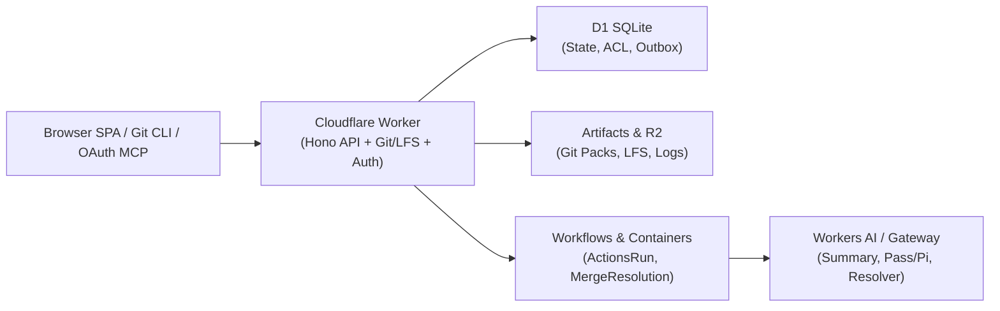

<!-- Modified by CyberNova for the CloudForge fork (forked 2026-10-22). Originally Apache-2.0 (see LICENSES/Apache-2.0.txt). -->

<p align="center">
  
</p>

<h1 align="center">CloudForge</h1>

<p align="center">
  <a href="https://github.com/CyberNova2333/cloudforge/actions/workflows/ci.yml"></a>
  <a href="https://cloudforge.cbnv.me/en/docs/"></a>
  <a href="LICENSE"></a>
</p>

<p align="center">
  <a href="README.md">简体中文</a> | <strong>English</strong>
</p>

<p align="center">
  <a href="https://cloudforge.cbnv.me/en/docs/">Docs Site</a> · <a href="#quick-start">Quick Start</a> · <a href="#reading-paths">Reading Paths</a>
</p>

CloudForge is a **single-tenant, self-hosted Git and AI code review platform running inside your own Cloudflare account** (forked from [choyiny/gitorange](https://github.com/choyiny/gitorange)), serving a React 18 SPA, Git HTTPS/LFS, Container Actions, DAG PR stacking, AI review, and OAuth 2.1 MCP from a single Worker for small teams or personal private hosting—not multi-tenant SaaS.

## Core Capabilities & Data Flow

- **Edge Git & R2 LFS**: Git objects and refs reside in Cloudflare Artifacts while large binaries stream directly via 15-minute presigned R2 URLs; the Worker enforces token permissions, branch protection, and `push_events` outbox recovery.
- **AI Reviewers, Stacking & Auto-Merge**: Repo-backed reviewer agents (`AGENT.md`, supporting single-pass and sandboxed `AgentReviewer` `engine: pi`) feed a single `reviewVerdict` gate, non-destructive `MERGE_RESOLUTION` PR stacking, and CAS fast-forward merges.
- **Container Actions & Commit Statuses**: Runs GitHub-compatible YAML workflows on Cloudflare Containers (`standard-1`–`standard-4`) with instance/repo concurrency queues and `cloudforge/relevance@v1` test pruning, unified with external commit statuses.
- **Collaboration & Integrations**: Includes issues sharing `#N` numbering (`Fixes #N` default-branch auto-close), inbox & email notifications, AES-GCM signed Webhooks with backoff retries, and single-repo `cfd_` HTTPS deploy tokens.
- **OAuth 2.1 `/mcp` & Policy Governance**: Exposes stateless Streamable HTTP `/mcp` (31 standard tools + 3 opt-in moderator approval tools) alongside mandatory MFA policies, explicit OIDC linking/SSO, and audit logs.

## Capabilities & Explicit Non-Goals

| Dimension             | What CloudForge Delivers                                                                                           | Explicit Non-Goals & Hard Bounds                                                                                                                                             |
| --------------------- | ------------------------------------------------------------------------------------------------------------------ | ---------------------------------------------------------------------------------------------------------------------------------------------------------------------------- |
| Git & Storage         | Artifacts Git Smart HTTP (branch protection + `push_events` outbox); 15-min R2 presigned Git LFS                   | **No SSH** (port 22 impossible on Workers); LFS locks return empty/`501`; new Artifacts repos cap at `1 GB` (Git v1)                                                         |
| Review, Stacking & CI | Single-pass + sandboxed `AgentReviewer` (`engine: pi`), non-destructive PR stacking, Cloudflare Containers Actions | Multi-team memberships and 5-tier repo roles stay gated (`rolePublishingAllowed: false`); no open multi-tenant signup                                                        |
| MCP & Feature Limits  | OAuth 2.1 JWT `POST /mcp` (`31+3` tools), AES-GCM Webhooks (`<=20/repo`) with SSRF blocks                          | `1 MB` API/MCP body cap; 100 D1 SQL bind params; excludes issue templates/milestones, cross-repo `#N`, Passkeys, branch webhook filters, cross-repo forks, and bundle export |



## Quick Start

Deploy directly to your own Cloudflare account using the zero-clone installer CLI (requires Node.js `>=22.18`, pnpm `12.6.0`, and a scoped Cloudflare API Token or `wrangler login`):

```bash
# Fresh production install: verifies scopes, creates D1/R2/Artifacts, runs 67 migrations, deploys
pnpm dlx @cybernova2333/cloudforge install

# Cloned repo: local full-stack development (Vite + workerd at http://localhost:8080)
pnpm install --frozen-lockfile
cp wrangler.jsonc.example wrangler.jsonc && cp .dev.vars.example .dev.vars
pnpm db:migrate:local && pnpm dev
```

Open your deployed URL to initialize the first site admin at `/setup`. Additional modes and recovery tools:

| Workflow / Mode                | Command or Guide                                                  | Notes                                                                                                             |
| ------------------------------ | ----------------------------------------------------------------- | ----------------------------------------------------------------------------------------------------------------- |
| Clone-based install or upgrade | `pnpm cloudforge install` / `upgrade` / `status`                  | See [Deployment Guide](https://cloudforge.cbnv.me/en/docs/deployment) and [docs/updating.md](docs/updating.md)    |
| Adopt an existing deployment   | `pnpm dlx @cybernova2333/cloudforge adopt`                        | Bring a manually deployed Worker/D1 under CLI upgrades; see [docs/updating.md](docs/updating.md)                  |
| Manual `wrangler.jsonc` deploy | `pnpm build && pnpm exec wrangler deploy`                         | See [Bindings & Vars Matrix](https://cloudforge.cbnv.me/en/docs/configuration) and [docs/setup.md](docs/setup.md) |
| Seed local demo repositories   | `pnpm seed:demo`                                                  | Populates sample PR stacks, findings, and runs; see [docs/development.md](docs/development.md)                    |
| Offline password or MFA reset  | `pnpm dlx @cybernova2333/cloudforge reset-password` / `reset-mfa` | Audited offline recovery without disabling instance MFA policy; see [FAQ](https://cloudforge.cbnv.me/en/docs/faq) |

## Pre-Adoption FAQ

- **Is Git over SSH supported?** No. Cloudflare Workers cannot listen on port 22; Git and LFS run strictly over HTTPS with Personal Access Tokens (PATs) or repo-scoped `cfd_` deploy tokens.
- **Can CloudForge host public multi-tenant registrations?** No. Each deployment serves one instance/organization with public signup disabled by default and at most one shared team namespace.
- **What are the Artifacts and D1 hard limits?** Newly created Artifacts repositories cap at 1 GB using Git protocol v1 (store large assets in R2 via Git LFS), and D1 SQLite enforces single-thread writes with max 100 bound parameters per query.
- **What happens if `AGENT_REVIEWER` is unbound or AI review is undesired?** `engine: pi` gracefully falls back to single-pass when `AGENT_REVIEWER` is absent, and any repository can opt out of inviting reviewer agents.
- **Are multi-team memberships and 5-tier repo roles live today?** No. Only internal Stage A mapping, read-only `access-preflight`, and the `access_runtime_state` protocol guard (`rolePublishingAllowed: false`) are active today.

## Reading Paths

| Goal                                         | Documentation Site (`docs-site/`)                                                                                                                                                                                      | Engineering & Reference Docs                                                                                                                |
| -------------------------------------------- | ---------------------------------------------------------------------------------------------------------------------------------------------------------------------------------------------------------------------- | ------------------------------------------------------------------------------------------------------------------------------------------- |
| Deploy, configure bindings & troubleshoot    | [Overview & Setup](https://cloudforge.cbnv.me/en/docs/) · [Configuration](https://cloudforge.cbnv.me/en/docs/configuration) · [FAQ](https://cloudforge.cbnv.me/en/docs/faq)                                            | [Setup Guide](docs/setup.md) · [Configuration Reference](docs/configuration.md)                                                             |
| Permissions, REST/MCP, Webhooks & tokens     | [Security & Boundaries](https://cloudforge.cbnv.me/en/docs/contracts-and-boundaries) · [API & MCP](https://cloudforge.cbnv.me/en/docs/apis-and-mcp) · [API & Component Reference](docs-site/en/api-reference/index.md) | [Webhooks](docs/webhooks.md) · [Deploy Tokens](docs/deploy-tokens.md) · [OIDC](docs/oidc.md)                                                |
| Author `AGENT.md`, CI relevance & UI i18n    | [Flows & Extensibility](https://cloudforge.cbnv.me/en/docs/interactions-and-extensibility)                                                                                                                             | [Auto-Merge](docs/auto-merge.md) · [CI Relevance](docs/ci-relevance.md) · [Issues](docs/issues.md) · [Notifications](docs/notifications.md) |
| Understand storage, review & Actions code    | [Architecture](https://cloudforge.cbnv.me/en/docs/architecture) · [Walkthrough](https://cloudforge.cbnv.me/en/docs/walkthrough)                                                                                        | [Chinese Living Guide](repo-docs/README.md) · [One Real Run](repo-docs/walkthroughs/one-real-run.md) · [Code Map](repo-docs/code-map.md)    |
| Upgrade D1 schema, inspect ADRs & contribute | [Migrations & ADRs](https://cloudforge.cbnv.me/en/docs/changelog-and-migrations) · [Code Map](https://cloudforge.cbnv.me/en/docs/code-map)                                                                             | [Updating](docs/updating.md) · [Development](docs/development.md) · [Contributing](CONTRIBUTING.md)                                         |

## License & Attribution

Licensed under [AGPL-3.0-only](LICENSE), forked on 2026-10-22 from [choyiny/gitorange](https://github.com/choyiny/gitorange) (`b3d5b08`, originally [Apache-2.0](LICENSES/Apache-2.0.txt)). CloudForge is an independent project and is not affiliated with or endorsed by GitHub, Inc.

- **Additional Terms & Assets**: Pursuant to Section 7 of GNU AGPLv3, Covered Material is governed by [`LICENSE-ADDITIONAL_TERMS-zh-CN.md`](LICENSE-ADDITIONAL_TERMS-zh-CN.md) (English reference translation: [`LICENSE-ADDITIONAL_TERMS-en.md`](LICENSE-ADDITIONAL_TERMS-en.md); the Simplified Chinese Full Text prevails), setting forth provenance, modification marking, anti-impersonation, conditional permissive-extension exemptions, and project identifier boundaries; engineering guidance is provided in [`IMPLEMENTATION-GUIDE.zh-en.md`](IMPLEMENTATION-GUIDE.zh-en.md), and the unified four-section manifest of human authors, AI assistants, upstream/third-party code, and independent artwork, fonts, and project identifiers is maintained in [`ASSETS_LICENSES.md`](ASSETS_LICENSES.md). Authorization for additional requirements and for Sections 9.5–9.6 additional permissions is verified separately per copyright holder; third-party or upstream materials remain governed by their existing valid licenses.
