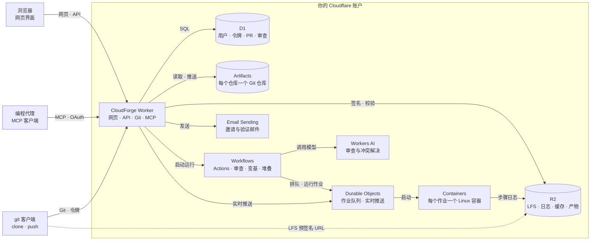

<!-- Modified by CyberNova for the CloudForge fork (forked 2026-10-22). Originally Apache-2.0 (see LICENSES/Apache-2.0.txt). -->

**简体中文** | [English](README.en.md)

<p align="center">
  
</p>

<p align="center">
  <a href="https://cnb.cool/CyberNova2333/cloudforge/-/build/logs"></a>
  <a href="LICENSE"></a>
  <a href="https://workers.cloudflare.com/"></a>
</p>

<h1 align="center">CloudForge</h1>

CloudForge 是部署在自己 Cloudflare 账户中的代码托管平台，将 Git 仓库、合并请求（PR）、持续集成和 AI 审查放在同一个应用中。它面向人与编程代理共同开发的团队：代理提交代码、处理检查和审查意见，人通过审查收件箱决定需要人工判断的问题。

> **分支声明**：本项目是 [choyiny/gitorange](https://github.com/choyiny/gitorange) 的独立分支，基于 2026-10-22 的 `b3d5b08`（见 [.fork-base](.fork-base)），与上游作者无隶属关系，也未获得其背书。
>
> 原始部分 © 2026 GitOrange contributors，采用 [Apache-2.0](LICENSES/Apache-2.0.txt)；修改部分 © 2026 CyberNova，组合后的作品采用 [GPL-3.0-or-later](LICENSE)。“GitOrange”及其标志属于上游项目，不作为本项目的产品标识。

## 主要功能

- **代码托管**：Git HTTPS、个人访问令牌、Git LFS、分支和标签、文件浏览、差异比较、PR 评论与版本发布。个人仓库支持私有、内部和公开可见性；团队仓库对实例成员可见，公开仓库允许匿名读取。
- **AI 审查团队**：提供安全、数据、性能、功能、可靠性、隐私和发布等预设审查代理。每个代理在自己的仓库中维护 `AGENT.md` 和 `knowledge/`，按仓库邀请后参与审查。
- **人工决策**：审查意见可以分派给有推送权限的成员。用户可按代理授权 AI 代为处理部分意见；安全、数据等受保护代理的人工确认项需要逐项填写理由，不允许 AI 代批。
- **代理学习**：PR 关闭后，系统可将被驳回的修改要求和人工教学备注整理为学习任务，更新代理的审查说明与知识文件。
- **PR 协调**：分析 PR 之间的依赖、冲突和相互影响，展示列表、看板与关系图；合并队列支持暂停，PR 状态说明下一步由代理处理、人工审查还是继续等待。
- **CI 与运行记录**：CloudForge Actions 在 Cloudflare Containers 中执行受支持的 GitHub Actions 工作流，提供日志、缓存、构建产物、变量与加密密钥。AI 任务也有步骤、模型调用和用量记录。
- **MCP 接入**：编程代理通过 OAuth 授权访问 `/mcp`，读取任务、创建 PR、查看检查和执行权限允许的操作。工具名为 `cloudforge_*`；早期的 `gitorange_*` 名称仍可调用（不在工具列表中显示），已有客户端无需修改。
- **使用与管理**：中英文界面、主题切换、实时更新、全局搜索、仓库健康概览、审查收件箱、邀请注册、自愿启用的 TOTP 双因素认证与一次性恢复码（[认证说明](docs/authentication.md)）、密码找回（登录页邮件链接、管理员生成的重置链接、无人能登录时用安装器命令 `reset-password`）、审计日志及实例设置。

## PR 如何流转

1. 成员或编程代理推送分支，通过网页或 MCP 创建 PR。
2. 匹配的 Actions 工作流运行检查；使用 `cloudforge/relevance@v1` 的工作流可按配置选择需要运行的测试模块。
3. 系统根据配置和代理触发规则发起审查，并分析 PR 与其他变更的关系。审查模式支持单次模型调用或使用只读工具的 `engine: pi`。
4. PR 页面展示失败检查、修改要求、需要人工确认的意见和等待原因。
5. 满足检查、审查、依赖及暂停规则后，PR 可以合并。邀请了审查代理的仓库启用自动合并，也可针对单个 PR 关闭；未邀请代理时由人审查和合并。
6. 合并采用变基后快进，并通过目标引用的比较并交换（CAS）检测并发变更。合并后是否删除分支由仓库设置决定，默认分支、受保护分支和仍被使用的分支会保留。

变基会保留提交作者和提交说明，但通常会改变提交 SHA。服务端变基后，客户端需要先获取远端分支并同步本地历史，再继续推送。审查输入、文件数量、模型上下文和运行时间均有上限，不能据此保证任意规模 PR 都能得到完整的 AI 审查。后台任务通过持久化步骤、状态校验与恢复机制处理重试，外部操作仍应按可能重复执行来设计。

详细规则见 [审查代理、PR 状态与自动合并](docs/auto-merge.md) 和 [架构说明](docs/architecture.md)。

## 从源码开始

源码运行需要 **Node.js 22.18 或更新版本**和 **Yarn**。部署还需要可用的 Cloudflare 账户、项目所用服务的权限，以及用于构建 Actions 运行器镜像的 Docker。安装器会检查所需服务和配置；发送邀请邮件需要配置 Email Sending，也可选择只使用邀请链接。

```bash
git clone https://cnb.cool/CyberNova2333/cloudforge.git
cd cloudforge
yarn install --frozen-lockfile
yarn wrangler login

# 先查看安装计划；此命令不应用计划
yarn cloudforge install --plan

# 确认计划后执行安装，会创建资源、迁移数据库并部署
yarn cloudforge install
```

安装结束后，使用安装器输出的一次性初始化码打开 `<BASE_URL>/setup` 并创建首位管理员。随后创建仓库、邀请成员；需要 AI 审查时，先创建审查代理，再在仓库设置中邀请它们。

```bash
# 查看安装状态
yarn cloudforge status

# 继续中断的安装
yarn cloudforge install --resume
```

完整部署步骤见 [安装指南](docs/setup.md)；更新和接管已有安装见 [更新指南](docs/updating.md)。这两份文档也介绍发布包的安装方式。

### 本地开发

```bash
cp wrangler.jsonc.example wrangler.jsonc
cp .dev.vars.example .dev.vars
# 按 docs/development.md 填写账户、开发环境和本地密钥
yarn db:migrate:local
yarn dev
```

默认地址为 `http://localhost:8080`，网页、API 与 Git 端点共用此地址。本地开发中的 D1 使用本地存储；Artifacts 访问真实 Cloudflare 服务。示例数据和 Git LFS 配置见 [本地开发指南](docs/development.md)。

### 检查与测试

```bash
yarn format:check
yarn typecheck
yarn test
```

`yarn test` 先运行 Node.js 环境中的安装器测试，再运行 workerd 环境中的 Worker 和前端纯逻辑测试；后者使用真实本地 D1 与内存 Artifacts 测试实现。测试分组、用例名称和默认结果摘要使用中文，原始断言、第三方诊断与堆栈保留原文。

CNB 使用 [.cnb.yml](.cnb.yml)，依次执行依赖安装、验证配置准备、格式检查、类型检查、构建和全部测试。GitHub 与 CloudForge 实例使用 [.github/workflows/](.github/workflows/) 中的配置。

## Actions 兼容范围

CloudForge 读取 `.github/workflows/`，实现其中一部分 GitHub Actions 语法；迁移工作流时应核对实际使用的功能。当前实现包括：

- `push` 和 `pull_request` 事件，以及分支、标签、路径筛选。
- Linux 容器中的 `run` 步骤，`bash`、`sh`、`python`、`node` 脚本及工作目录设置。
- `actions/checkout`、`actions/setup-node`、`actions/cache`、产物上传与下载；来自 GitHub 或仓库本地的 JavaScript 与组合动作。
- `needs`、条件表达式、矩阵展开、环境变量、步骤与任务输出，以及 `GITHUB_ENV`、`GITHUB_OUTPUT` 和 `GITHUB_PATH`。
- 仓库级与实例级变量和加密密钥、日志脱敏、任务并发限制与排队。

`ubuntu-latest` 映射到 CloudForge 的 Linux 容器规格，不代表 GitHub 托管运行器的完整镜像；`setup-node` 使用运行器镜像中的 Node.js。Windows、macOS 运行器及 GitHub 平台专有能力不能直接按 GitHub 的行为假定。相关性检查的配置见 [跳过无关测试](docs/ci-relevance.md)。

## 架构与费用



| 组件                                         | 用途                                                 |
| -------------------------------------------- | ---------------------------------------------------- |
| Cloudflare Workers                           | 同源网页、API、Git HTTPS 和 MCP 服务                 |
| Artifacts                                    | Git 对象与引用，每个 CloudForge 仓库对应一个存储仓库 |
| D1                                           | 用户、仓库元数据、PR、审查、设置与审计事件           |
| R2                                           | Git LFS、Actions 日志、缓存和构建产物                |
| Workflows、Durable Objects、Containers       | 持久化任务编排、实时连接、AI 任务与 CI 执行          |
| Workers AI、AI Gateway、Agents SDK、Computer | 模型调用、用量记录及代理沙箱；模型可在实例设置中调整 |
| Email Sending、Cron、Analytics API           | 邮件、定期清理与恢复、用量统计                       |

费用取决于启用的服务、套餐和实际用量，不是固定月费。请按部署时的官方价格核算：[Workers](https://developers.cloudflare.com/workers/platform/pricing/)、[Artifacts](https://developers.cloudflare.com/artifacts/platform/pricing/)、[Containers](https://developers.cloudflare.com/containers/pricing/)、[Workers AI](https://developers.cloudflare.com/workers-ai/platform/pricing/) 和 [R2](https://developers.cloudflare.com/r2/pricing/)。应用中的用量和费用页面提供估算，实际账单以 Cloudflare 为准。

## 文档与贡献

[安装](docs/setup.md) · [更新](docs/updating.md) · [配置](docs/configuration.md) · [架构](docs/architecture.md) · [本地开发](docs/development.md) · [审查与自动合并](docs/auto-merge.md) · [CI 相关性检查](docs/ci-relevance.md)

贡献说明见 [CONTRIBUTING.md](CONTRIBUTING.md)，安全问题报告方式见 [SECURITY.md](SECURITY.md)。仓库包含 [CLAUDE.md](CLAUDE.md) 及 `.claude/` 中的辅助技能和钩子，供相应开发工具使用。

## 许可证与声明

本分支采用 [GNU GPL v3.0 或更新版本](LICENSE) 发布。上游原始部分继续适用 [Apache License 2.0](LICENSES/Apache-2.0.txt)，其许可证和版权声明保持不变；第三方包和字体适用各自许可证，见 [THIRD_PARTY_NOTICES.md](THIRD_PARTY_NOTICES.md)。

相对上游修改的文件保留首行 `Modified by CyberNova for the CloudForge fork` 声明。不能承载此注释或由工具生成的例外包括 `package.json`、`migrations/meta/_journal.json`、`worker/worker-configuration.d.ts`，以及 `public/logo.png`、`public/favicon.png` 和 `public/apple-touch-icon.png`。

CloudForge 与 GitHub 无隶属关系，也未获得其背书；“GitHub”是 GitHub, Inc. 的商标。以独立品牌发布衍生产品时，请更换名称和标志，避免混淆。

## 源码阅读与文档站

从[中文阅读路径](repo-docs/README.md)进入[一次真实主流程](repo-docs/walkthroughs/one-real-run.md)，再查[代码地图](repo-docs/code-map.md)与[源码证据](repo-docs/references/source-evidence.md)。指南明确限定覆盖范围，不把未运行的测试写成通过。

独立文档站基于 VitePress，其依赖与业务项目完全分离（`docs-site/package.json`）。正文单一维护于 `repo-docs/` 并由站点直接 include 引入；网页中的源码链接显示为安全精确路径，源码与本机私有资产不打包进静态产物。内置全离线自托管字体（IBM Plex Sans、JetBrains Mono）、Primer 功能色昼夜切换与渐进式动效降级支持。

```sh
yarn --cwd docs-site install --frozen-lockfile
yarn --cwd docs-site docs:dev --host 127.0.0.1
yarn --cwd docs-site docs:build
yarn --cwd docs-site docs:preview
```

默认输出至 `docs-site/.vitepress/dist/`；独立验证可追加 `-- --outDir <仓库外绝对目录>`。文档构建只验证技术说明页面呈现，不代表业务可用或已部署。

管理员可预览并启用全员 MFA，受限会话、OAuth 撤销与离线恢复边界见 [认证说明](docs/authentication.md#管理员认证策略)。
