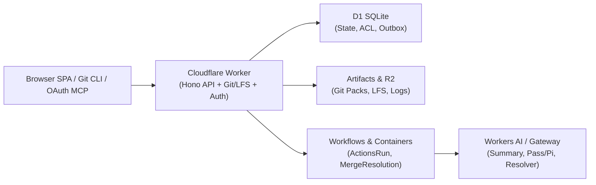

<!-- Modified by CyberNova for the CloudForge fork (forked 2026-10-22). Originally Apache-2.0 (see LICENSES/Apache-2.0.txt). -->

<p align="center">
  
</p>

<h1 align="center">CloudForge</h1>

<p align="center">
  <a href="https://github.com/CyberNova2333/cloudforge/actions/workflows/ci.yml"></a>
  <a href="https://cloudforge.cbnv.me/docs/"></a>
  <a href="LICENSE"></a>
</p>

<p align="center">
  <strong>简体中文</strong> | <a href="README.en.md">English</a>
</p>

<p align="center">
  <a href="https://cloudforge.cbnv.me/docs/">在线文档站</a> · <a href="#快速开始">快速开始</a> · <a href="#文档导览">文档导览</a>
</p>

CloudForge 是一个**部署在你自己 Cloudflare 账户内的单租户自托管 Git 与 AI 代码审查平台**（基于 [choyiny/gitorange](https://github.com/choyiny/gitorange) 分叉演进），在一个 Worker 同源提供 React 网页、Git HTTPS/LFS、容器 Actions、PR 堆叠、AI 审查与 OAuth 2.1 MCP，面向中小团队及个人私有托管，不适用于多租户公开 SaaS。

## 核心能力与数据流

- **边缘 Git 与 R2 LFS**：仓库对象与引用托管在 Cloudflare Artifacts，大二进制经 15 分钟预签名 R2 URL 直传；Worker 统一守卫令牌、分支保护与 `push_events` 断点恢复。
- **AI 审查、PR 堆叠与自动落地**：邀请自带 `AGENT.md` 的审查 Agent（支持单轮 Pass 与隔离 `AgentReviewer` 深度工具审查 `engine: pi`），自动计算 `MERGE_RESOLUTION` 无重推 PR 堆叠，并经唯一 `reviewVerdict` 门禁变基快进合并。
- **容器 Actions 与外部状态门禁**：在 Cloudflare Containers（`standard-1`–`standard-4`）按实例/仓库并发限额运行 GitHub 兼容工作流（含 `cloudforge/relevance@v1` 相关性跳测），与外部 CI 上报的提交状态共同决定能否合并。
- **日常协作与出站集成**：内置与 PR 共用编号的议题（支持 `Fixes #N` 落地自动关闭）、站内与邮件通知、AES-GCM 密封密钥与退避重试的 Webhooks、以及限定单仓库的 `cfd_` HTTPS 部署令牌。
- **OAuth 2.1 `/mcp` 与强制 MFA 治理**：面向编码代理的无状态 Streamable HTTP `/mcp`（31 个标准工具 + 需显式授权的 3 个 moderator 审批工具），并支持管理员强制 MFA、OIDC 单点绑定与完整审计日志。

## 能做到什么程度与明确不能做什么

| 维度            | 能做到什么程度（已实现能力）                                                                                     | 明确不能做什么（非目标与硬限制）                                                                                                     |
| --------------- | ---------------------------------------------------------------------------------------------------------------- | ------------------------------------------------------------------------------------------------------------------------------------ |
| 仓库与传输      | Artifacts 托管 Git Smart HTTP（带分支保护与 `push_events` 恢复）；15 分钟 R2 预签名 Git LFS 直传                 | **不支持 SSH**（Workers 不能监听 `22` 端口）；LFS Locking 返回空/`501`；新建 Artifacts 仓限 `1 GB` 且仅 Git v1                       |
| 审查、堆叠与 CI | 单轮 Pass + 沙箱 `AgentReviewer`（`engine: pi`）、无破坏 `MERGE_RESOLUTION` PR 堆叠、`Containers` Actions 工作流 | 多团队成员关系与五级角色保持关闭（`rolePublishingAllowed: false`）；不提供公开多租户 SaaS 自助注册                                   |
| MCP 与扩展范围  | OAuth 2.1 JWT `POST /mcp` 暴露 `31+3` 工具，出站 AES-GCM Webhooks（≤20/仓）+ SSRF 内网封堵                       | `/api/*` 与 `/mcp` 限 `1 MB`、D1 限 `100` 绑定参数；不含议题模板/里程碑、跨仓 `#N`、Passkey、分支 Webhook 过滤、公开 Fork 与一键导出 |



## 快速开始

使用零克隆官方安装 CLI 将 CloudForge 部署到你自己的 Cloudflare 账户（需 Node.js `>=22.18`、pnpm `12.6.0` 及具备对应资源权限的 Cloudflare API Token 或 `wrangler login`）：

```bash
# 全新安装：自动检核权限、创建 D1 / R2 / Artifacts、执行 67 份迁移并部署 Worker
pnpm dlx @cybernova2333/cloudforge install

# 克隆源码场景：本地全栈开发（Vite + workerd，默认 http://localhost:8080）
pnpm install --frozen-lockfile
cp wrangler.jsonc.example wrangler.jsonc && cp .dev.vars.example .dev.vars
pnpm db:migrate:local && pnpm dev
```

部署完成后访问实例首页即自动进入 `/setup` 创建首个站点管理员；其他运行、升级与接管方式见下表：

| 使用场景                   | 入口命令或文档                                                    | 说明                                                                                                      |
| -------------------------- | ----------------------------------------------------------------- | --------------------------------------------------------------------------------------------------------- |
| 从克隆仓库安装或升级       | `pnpm cloudforge install` / `upgrade` / `status`                  | 详见 [部署与运维指南](https://cloudforge.cbnv.me/docs/deployment) 与 [docs/updating.md](docs/updating.md) |
| 接管已有手工实例           | `pnpm dlx @cybernova2333/cloudforge adopt`                        | 把已有 Worker/D1 纳入安装器升级管理，见 [docs/updating.md](docs/updating.md)                              |
| 手工 `wrangler.jsonc` 部署 | `pnpm build && pnpm exec wrangler deploy`                         | 绑定、Secrets、Cron 与 API Token 权限见 [配置矩阵](https://cloudforge.cbnv.me/docs/configuration)         |
| 灌入本地演示仓库数据       | `pnpm seed:demo`                                                  | 向本地开发实例写入示例团队、PR 堆叠与审查状态，见 [docs/development.md](docs/development.md)              |
| 离线账户或 MFA 恢复        | `pnpm dlx @cybernova2333/cloudforge reset-password` / `reset-mfa` | 不削弱实例策略的带审计离线恢复，详见 [排错与恢复 FAQ](https://cloudforge.cbnv.me/docs/faq)                |

## 选型前常见问题

- **支持 SSH 拉取或推送吗？** 不支持。Cloudflare Workers 无法监听 22 端口，所有 Git 与 LFS 操作均通过 HTTPS 配合个人访问令牌（PAT）或单仓库 `cfd_` 部署令牌完成。
- **能否把它当成多租户公开代码托管平台？** 不能。CloudForge 为“一实例一组织”单租户设计，所有实例成员共用站点与至多一个全局共享团队命名空间，公共自助注册默认关闭。
- **Artifacts 与 D1 有哪些硬边界？** 新建 Artifacts 仓库上限 1 GB 且推送仅支持 Git 协议 v1（大文件需走内置 Git LFS 直传 R2）；D1 为单线程 SQLite 且每条 SQL 最多 100 个绑定参数。
- **如果没有配置 `AGENT_REVIEWER` 或不想让 AI 代审会怎样？** 缺少 `AGENT_REVIEWER` 时 `engine: pi` 自动优雅退回单轮 Pass；任何仓库也可完全不邀请审查 Agent，或保持 `review.allow_self_approval` 与 `Let Claude decide` 关闭。
- **未来多团队与五级角色模型现在能直接开启吗？** 不能。目前仅落地阶段 A 兼容映射、只读预检 `access-preflight` 与协议守卫 `access_runtime_state`（`rolePublishingAllowed: false`），完整多团队授予仍待后续版本开放。

## 文档导览

| 阅读目标                            | 官方文档站（`docs-site/`）                                                                                                                                                                   | 仓库源码指南与底层规范                                                                                                               |
| ----------------------------------- | -------------------------------------------------------------------------------------------------------------------------------------------------------------------------------------------- | ------------------------------------------------------------------------------------------------------------------------------------ |
| 初次评估、上线部署与排错            | [起步与部署](https://cloudforge.cbnv.me/docs/) · [配置矩阵](https://cloudforge.cbnv.me/docs/configuration) · [FAQ](https://cloudforge.cbnv.me/docs/faq)                                      | [安装向导说明](docs/setup.md) · [配置与环境变量参考](docs/configuration.md)                                                          |
| 访问权限、API、MCP 与出站集成       | [权限与安全边界](https://cloudforge.cbnv.me/docs/contracts-and-boundaries) · [API 与 MCP](https://cloudforge.cbnv.me/docs/apis-and-mcp) · [API 与组件参考](docs-site/api-reference/index.md) | [Webhook 规范](docs/webhooks.md) · [部署令牌](docs/deploy-tokens.md) · [OIDC](docs/oidc.md)                                          |
| 定制审查 Agent、`relevance` 与 i18n | [跨模块协同与扩展](https://cloudforge.cbnv.me/docs/interactions-and-extensibility)                                                                                                           | [自动合并与堆叠](docs/auto-merge.md) · [相关性筛选](docs/ci-relevance.md) · [议题](docs/issues.md) · [通知](docs/notifications.md)   |
| 深入存储、审查、Actions 与认证源码  | [系统架构与拓扑](https://cloudforge.cbnv.me/docs/architecture) · [主流程拆解](https://cloudforge.cbnv.me/docs/walkthrough)                                                                   | [工程指南总入口](repo-docs/README.md) · [一次真实主流程](repo-docs/walkthroughs/one-real-run.md) · [代码地图](repo-docs/code-map.md) |
| 版本升级、D1 迁移、ADR 与贡献测试   | [迁移历史与 ADR](https://cloudforge.cbnv.me/docs/changelog-and-migrations) · [源码地图](https://cloudforge.cbnv.me/docs/code-map)                                                            | [升级边界](docs/updating.md) · [开发与测试](docs/development.md) · [贡献指南](CONTRIBUTING.md)                                       |

## 许可证与致谢

本项目整体以 [AGPL-3.0-only](LICENSE) 发布，衍生自 [choyiny/gitorange](https://github.com/choyiny/gitorange)（2026-10-22 分叉于提交 `b3d5b08`，原项目采用 [Apache-2.0](LICENSES/Apache-2.0.txt) 许可）。CloudForge 与 GitHub, Inc. 无任何关联、赞助或官方背书关系。

- **附加条款与资产规则**：本项目依据 GNU AGPLv3 第 7 条适用 [`LICENSE-ADDITIONAL_TERMS-zh-CN.md`](LICENSE-ADDITIONAL_TERMS-zh-CN.md)（英文参考译文：[`LICENSE-ADDITIONAL_TERMS-en.md`](LICENSE-ADDITIONAL_TERMS-en.md)，以简体中文完整版正文为准），对来源陈述、修改标识、禁止冒充、扩展模块有条件附加许可及项目标识边界作出补充说明；工程落地参考见 [`IMPLEMENTATION-GUIDE.zh-en.md`](IMPLEMENTATION-GUIDE.zh-en.md)，人员署名、AI 辅助工具、上游/第三方代码及独立美术字体与标识资产综合清单见 [`ASSETS_LICENSES.md`](ASSETS_LICENSES.md)。附加要求与第 9.5–9.6 款附加许可豁免均分别核实相应版权持有人有效授权，未取得该等授权的第三方或上游材料仍受其原有有效许可约束。
