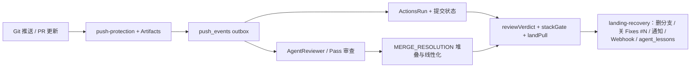

# 跨模块协同、审查 Agent 编写与国际化

了解单点契约之后，本页说明各功能模块如何通过 D1 状态与事件联动，以及如何在团队中定制审查 Agent、相关性检查与双语界面词典。

## 1. 核心跨模块协同路径



- **推送后联动**：每次分支或标签更新先写 `push_events`，随后触发四条并行轨：刷新 `AGENT.md` 配置（若命中 Agent 自有仓库）、创建/更新 PR、触发 `ActionsRun` 工作流并向上游注入 `before` SHA、以及向订阅的 Webhook 队列入库。
- **审批门禁与自动落地**：无论是人手动点 **Merge**、MCP 调用还是后台 `autoMergeRepository`，全部走同一个 `landPull` 入口，按固定顺序核验：**合并暂停状态**（`merging_paused_at`）→ **堆叠门禁**（`stackGate` + `carriedPull`）→ **检查总评**（Actions + 提交状态 `checksAt`）→ **审查门禁**（`reviewVerdict`）→ **目标分支 CAS 快进**。
- **PR 关闭与议题联动**：标题或正文中不在代码块内的 `Fixes #N` / `Closes #N` / `Resolves #N`（同一仓库内存在的编号）在创建或编辑时写入 `issue_links`；当 PR 最终**合并进默认分支**（合并进堆叠父分支时不关闭）时，`landing-recovery.ts` 按检查点将其置为 `completed` 并触发站内与邮件通知。
- **Web 实时刷新（`LiveHub`）**：所有成功的仓库突变请求及 Workflow 每一步均向 `LiveHub` 发出轻量 ping（不含业务负载）；浏览器每 tab 维护单一 WebSocket 并合并抖动重新拉取视图。

## 2. 编写与调教审查 Agent（`AGENT.md`）

站点管理员在 **站点管理 → Agents** 创建 Agent 后，系统生成 `<handle>/<handle>` 内部仓库并预置 `AGENT.md`、`avatar.png` 与 `knowledge/README.md`。仓库管理员在仓库设置邀请后，每次 PR head 提交更新都会触发对应 Agent 审查。

```markdown
---
name: api-contract-reviewer
bio: 审查 API 路由权限、Zod 校验上限与 D1 批处理参数限制
facet: security
guarded: true
engine: pi
trigger:
  ask: review API endpoints, schema validation, and D1 query bounds
  above: 15
---

检查新增路由是否正确挂载鉴权守卫，数组或 `json_each` 参数不能超过 D1 每条 SQL 100 个绑定的限制。
```

- **`engine: pass` vs `engine: pi`**：`pass` 直接用 `ai.review_model` 单轮分析 Diff；`pi` 在 `AgentReviewer` DO 中挂载只读 `/repo` 文件检索，适合跨文件引用核查（仓库根目录可放 `.orangeignore` 排除生成物或大体量夹具）。
- **`guarded: true` 与 `facet: security|data`**：这两类 Agent 提出的 `needs_person` 意见强制要求人类附带理由审批（422 拒空理由），且禁止通过 `Let Claude decide`（`ai_delegations`）自动代决。
- **从人机反馈自学习**：当 PR 关闭时，只要有人员批准覆盖了某 Agent 的 `change_requested` 或附带 **teach note**，且 `review.learning` 为开启状态，后台会将一条 `agent_lessons` 送入只读+有限写沙箱，由 Agent 自主归纳沉淀到 `knowledge/**`（严格禁止改动 `AGENT.md` frontmatter，总变更不超过 20 KB），并在下次评审生效。

## 3. 相关性筛选（`cloudforge/relevance@v1`）

为了避免文档、前端静态资源等局部改动空跑全部耗时后端分片测试，CloudForge 工作流内置 `cloudforge/relevance@v1` 步骤（源码 `worker/src/actions/relevance.ts`，本仓库 `.github/workflows/ci.yml` 即是标准示例）：步骤接收 `modules` 声明映射后交由 `SUMMARY_MODEL` 判定变更路径可能影响的模块，生成 `needs.gate.outputs.run-<module>`，对 `pull_request` 且确定无关的测试模块安全跳过（推送主干及无明确判定时保守全跑；完整规则说明保留在仓库 `docs/ci-relevance.md`）。

## 4. 前端界面多语言与词典校验

React 前端采用“**英文源码字面量作翻译键**”方案（`src/lib/i18n.ts` 与 `src/locales/zh/*.ts`）：

1. 语言优先级依次为：**账户偏好**（`GET/PUT /api/me/preferences`）→ **本地切换**（`localStorage`）→ **实例默认语言**（`ui.default_language`）→ **浏览器语言**（`zh*` 优先中文，其余默认英文）；
2. 开发 UI 文案时使用 `t('...')`、`tn(count, ...)`、`tx(...)`（不可用模板字符串或拼接动态构造键），后端固定错误经 `tServer()` 与 `src/locales/zh/errors.ts` 匹配翻译；
3. 新增字符串后可运行内置辅助脚本检查未包裹英文或缺失词条，并在 `src/lib/i18n.test.ts` 中通过全量占位符与重复键检查：

```bash
node scripts/i18n/i18n-strings.mjs src/pages/overview/Home.tsx
node scripts/i18n/i18n-missing.mjs src/pages/overview/Home.tsx
```
