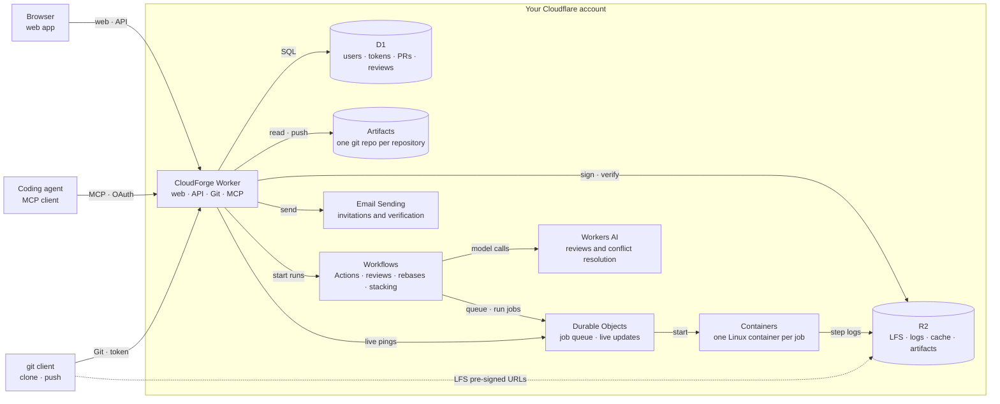

<!-- Modified by CyberNova for the CloudForge fork (forked 2026-10-22). Originally Apache-2.0 (see LICENSES/Apache-2.0.txt). -->

# Architecture

CloudForge is one Cloudflare Worker backed by D1, Artifacts, and R2, with Actions jobs running on Cloudflare Workflows and Containers.

The diagram is Mermaid: CNB, GitHub and CloudForge render it, and it is edited as text in this file, README.md and README.en.md.

| Concern                                                                                   | Where it lives                                                                                                                                                                                                                                                                  |
| ----------------------------------------------------------------------------------------- | ------------------------------------------------------------------------------------------------------------------------------------------------------------------------------------------------------------------------------------------------------------------------------- |
| Git objects and refs (branches, commits, files)                                           | **Cloudflare Artifacts** — one Artifacts repo per CloudForge repository                                                                                                                                                                                                         |
| Users, sessions, invitations, access tokens, repository metadata, pull requests, comments | **D1**                                                                                                                                                                                                                                                                          |
| Invitation emails                                                                         | **Cloudflare Email Sending**                                                                                                                                                                                                                                                    |
| Git LFS file contents                                                                     | **R2**, one object per repository and oid; D1's `lfs_objects` records which objects each repository has                                                                                                                                                                         |
| Actions runs, jobs, and steps                                                             | **D1** (`workflow_runs`, `workflow_jobs`, `workflow_steps`); step logs in **R2**; jobs run in **Cloudflare Containers**                                                                                                                                                         |
| OAuth clients, consents, tokens, and signing keys for the MCP server                      | **D1**, in better-auth's generated tables (`oauth_*`, `jwkss`)                                                                                                                                                                                                                  |
| Reviews                                                                                   | **D1** (`pr_classifications` per head commit, `pr_reviewers`, `pr_review_flags`, `pr_approvals`); runs on **Workflows** and **Workers AI** (GLM-5.3-flash, Clef, GLM-5.3)                                                                                                       |
| Let Claude decide                                                                         | **D1** (`ai_delegations`: which agents' findings each person hands to CloudForge AI); decisions on `pr_review_flags`; **Workers AI** (the agent review model)                                                                                                                   |
| Audit log                                                                                 | **D1** (`audit_events`, merged on read with `pr_events`)                                                                                                                                                                                                                        |
| Rebases and AI conflict resolution                                                        | **D1** (`merge_resolutions`: one row per pull request, tips and conflicting commit); rebased branches and `refs/pull/N/pre-rebase/*` in **Artifacts**; transcripts in **R2**; runs on **Workflows**, **Durable Objects** (Cloudflare Computer + Pi Durable), and **Workers AI** |
| Pi reviews (`engine: pi`)                                                                 | **D1** (`pr_reviewers`, `pr_review_flags`, `ai_usage`); one `AgentReviewer` **Durable Object** per attempt (Cloudflare Computer workspace + Pi Durable), deleted when the review ends; **Workers AI**; nothing in R2                                                            |
| Reviewer agents                                                                           | **D1** (`agents`, `repository_agents`); each agent's `AGENT.md`, `avatar.png` and `knowledge/` in its own **Artifacts** repository                                                                                                                                              |
| Agent learning                                                                            | **D1** (`agent_lessons`, the `learned` event in `pr_events`, `ai_usage`); the `AgentReviewer` **Durable Object** in learn mode, one per lesson attempt; each learned edit is a commit in the agent's **Artifacts** repository                                                   |
| Live updates                                                                              | One **Durable Object** (`LiveHub`, hibernating WebSockets); stores nothing                                                                                                                                                                                                      |
| Web interface                                                                             | React SPA in `src/` (the HQ shell and design system over Primer CSS; themes per browser), served from the same Worker via the `ASSETS` binding                                                                                                                                  |

Nothing about git content is copied into D1. The repository page, history, and diffs are read from Artifacts on each request.

## Repository identity

Each repository row has an immutable `artifacts_name` (`r_<id>`). The Artifacts repo is addressed by that name, so renaming `alice/api` changes one D1 row and never touches storage.

## The git endpoint

`https://host/<owner>/<repo>.git` is served by [`worker/src/git-http.ts`](../worker/src/git-http.ts):

1. The client sends Basic auth with a personal access token (stored in D1 as a SHA-256 hash).
2. The worker checks the user's permission on the repository: read for `git-upload-pack` (clone/fetch), write for `git-receive-pack` (push).
3. It mints a 5-minute Artifacts token scoped to that one repository (read or write) and streams the request to the Artifacts remote.

Artifacts credentials never leave the worker.

## Reads

The repository UI uses the Artifacts binding directly: `readTree`, `readCommit`, `readBlob`, `readFile`, and `log`. Branch lists come from the git smart-HTTP ref advertisement. See [`worker/src/git/service.ts`](../worker/src/git/service.ts).

## Pull requests and merging

Merging is rebase + fast-forward. Artifacts has no merge API and the binding cannot write objects, so CloudForge writes git itself:

1. Rebase the PR's commits onto the target when needed, using three-way tree merges (`git/rebase.ts`). Conflicts stop the rebase or go through the configured resolver. Review, checks, stack dependencies (including cycles), and the repository's merge pause gate landing.
2. Compute the landed commit list before changing the target, and save a `landing_intents` row in D1. First push a receipt at `refs/pull/<n>/landings/<intent id>` and pin the PR head; then recheck the PR and fast-forward only the target ref with compare-and-swap. A concurrent target push cannot be overwritten. This does not depend on atomic updates across multiple Git refs.
3. Record the merged PR, event, audit entry, and landing checkpoint in one D1 batch. Follow-up work (stack reconciliation, branch cleanup, Actions, agent config, and lessons) has separate completion checkpoints and stable Workflow identifiers.
4. A retry or daily retention cron resumes an interrupted landing (`merge/landing-recovery.ts`). Recovery requires both its saved receipt and the landed head to be reachable from the target, so an unrelated already-contained PR is not automatically marked merged. An attempt whose target has moved off its base without its result (`landingStatus` `stale`) can never take its compare-and-swap: the refused push, a later merge or recovery closes it, so neither later merges nor recovery re-check it.

Git and D1 do not share a transaction. A force-push that removes the landed commit before recovery removes the evidence needed for automatic recovery; an identical manual push after a prepared receipt is indistinguishable from the intended landing. Preserve the target history while resolving an interrupted landing.

On merge or close, the head commit is pinned at `refs/pull/<n>/head`, so a pull request's diff stays viewable after its branch is deleted.

## Actions

CloudForge Actions runs `.github/workflows/*.yml` files with GitHub Actions syntax ([`worker/src/actions/`](../worker/src/actions/)).

1. **Trigger.** The git endpoint snapshots the refs before a push and diffs them after it lands; an in-app merge reports its own ref update; opening a pull request triggers `pull_request`. For each moved branch or tag, [`trigger.ts`](../worker/src/actions/trigger.ts) reads the workflow files at the new commit, applies the `on:` filters (branches, tags, paths), and writes a queued run with its jobs (matrix expanded) and steps to D1 **before** starting a Cloudflare Workflow (`ACTIONS_RUN`) named after the run id. An invalid workflow file becomes a failed run with the parse error.
2. **Execute.** The `ActionsRun` Workflow ([`executor.ts`](../worker/src/actions/executor.ts)) runs jobs in waves by `needs`, in parallel within a wave. Every status change and every job step is a durable Workflow step, so a run survives restarts. Expressions, `if:` conditions, `env` layering, step outputs, and `GITHUB_ENV`/`GITHUB_PATH` are evaluated in the Worker.
3. **Run.** Each job gets a `JobRunner` Durable Object ([`job-runner.ts`](../worker/src/actions/job-runner.ts)) that starts its own container (scheduling policy `durable_object`, image `runner`, instance size from `runs-on`) and runs each step with `exec`. `actions/checkout` fetches the commit with a short-lived read-only Artifacts token, passed through an environment variable and masked in the log. The object keeps only the running step's output in memory for live logs, plus an alarm that destroys the container if its run disappears. Before its container starts, each job asks the `ActionsQueue` Durable Object ([`queue.ts`](../worker/src/actions/queue.ts)) for a slot: at most `actions.max_concurrent_jobs` (Site admin → Settings, default 10) jobs run at once across the instance, granted first come, first served. A waiting job holds no container: its Workflow waits for a grant event and asks again after 5, 10, 20, then every 30 minutes in case one was lost, and the run page shows "Queued (N ahead)" (also for a restarted job waiting again). If the queue can't be reached, the job runs without a slot rather than failing. A job gives its slot back when it finishes or its runner is interrupted (the restart queues again); cancelling a run drops its jobs from the queue; and an alarm reclaims slots whose job is gone or finished, whose run is finished or whose Workflow errored, was terminated, or completed (an errored or terminated run is marked finished), or that were held 15 minutes past the job's deadline (from its container's start: `timeout-minutes` plus 30 minutes per cache save; a granted job that hasn't started gets 30 minutes to notice).
4. **Logs.** Each finished step's log goes to R2 (`actions/<repository id>/...`); while a step runs, the logs endpoint reads it from the job's `JobRunner`. Deleting a repository deletes its logs. Workflow commands an action prints (`::add-mask::`, `::group::`, `::error::`, …) are applied to the log: masked values become `***`, groups become headings, debug lines are dropped.

**Actions.** `actions/checkout`, `setup-node`, `cache`, `upload-artifact`, `download-artifact` and `cloudforge/relevance`
are built in (the Worker writes their shell). Anything else is a JavaScript or composite action, read the way GitHub's
runner does ([`remote.ts`](../worker/src/actions/remote.ts)): `owner/repo[/path]@ref` from GitHub (the Worker fetches
`action.yml` from raw.githubusercontent.com, cached 10 minutes; the runner downloads the code from codeload.github.com
once per job into `/opt/cloudforge/actions`), or `./path` in the repository (read at the run's commit; the step needs a
checkout first). A JavaScript action's `pre`/`main` run with the image's Node.js, with `INPUT_*`, `GITHUB_ACTION_PATH`,
`GITHUB_EVENT_PATH` and `RUNNER_TOOL_CACHE`; what it saves to `$GITHUB_STATE` reaches its `post` entry point as
`STATE_*`. Planning never fetches an action, so every GitHub or local action gets a "Post" step slot (trigger and executor share
`hasPostStep`), skipped at run time when the action has no `post` or its `post-if` is false. A composite action's steps
run one by one within the step (nested up to 5 deep) with its `inputs`, `env`/`GITHUB_ENV`/`GITHUB_PATH` carried
between them, and its `outputs` evaluated at the end. Docker actions (`using: docker`, `docker://`) can't run: the job
container has no Docker.

**Matrix.** `strategy.matrix` follows GitHub's expansion ([`plan.ts`](../worker/src/actions/plan.ts) `expandMatrix`):
the axes' cross product, minus the combinations an `exclude` entry matches (objects match field by field), then each
`include` entry merged into every combination whose original values it doesn't change, or added as its own job.
Values may be objects and lists. Matrices built by expressions (`fromJSON`) aren't supported. A workflow may expand
to at most 20 jobs. Expansion rejects oversized products before allocating them; a matrix with exclusions may
inspect at most 1,024 combinations, and at most 20 include entries.

**Secrets and variables** ([`secrets.ts`](../worker/src/actions/secrets.ts)): `${{ secrets.X }}` and `${{ vars.X }}`
come from one D1 table, `actions_variables`: a repository's own rows (managed by its admins, Settings → Secrets and
variables) and instance-wide ones (repository null, managed by site admins, Site admin → Actions secrets and
variables); a repository's row of the same kind and name wins. Names are upper-cased, GitHub's rules, never
`GITHUB_`/`CLOUDFORGE_`; values up to 48 KB. A secret is stored as AES-256-GCM ciphertext under a key derived (HKDF)
from the `ACTIONS_SECRETS_KEY` Worker secret, with the row's scope and name as associated data; no route returns it.
A job reads and decrypts them when it starts, outside any durable Workflow step (step results are persisted), and
every log of the run masks them, however short, and each line of a multi-line one that could be secret alone (at
least 4 characters with a letter or digit, so never a lone `{` or `}`), both in the runner and when the Worker stores a
log. `add-mask` values follow the same rule. A job output that would carry a secret to another job is withheld (as on GitHub). Without the key, or for a
secret saved under another key, `secrets.X` is empty and "Set up job" says why. Saves and deletes are audited
(`secret.*`, `variable.*`; names only). There is no `GITHUB_TOKEN` yet.

Durable results containing step outputs, command-file environment, post-action state, or registered masks are
encrypted too (`state.ts`). AES-GCM binds each value to its repository, run, and step, with a separate key derivation
from `ACTIONS_SECRETS_KEY` (or `BETTER_AUTH_SECRET` when no Actions key is configured). Ciphertext over 512 KiB
is stored under the run's R2 log prefix; the Workflow result holds only its key, below Workflows' 1 MiB result limit.
Run retention deletes these objects with the logs. `add-mask` registrations and short-lived checkout/cache/artifact
credentials survive later steps and Workflow replay as encrypted masks. Overlapping secret matches are masked together;
the runner processes commands before truncating logs and withholds incomplete lines from live output. Each exec
uses `/usr/bin/timeout` to terminate its process group, escalating to SIGKILL after five seconds. A step counts as
timed out only when it exits 124 or 137 at or past its deadline; an earlier 137 (the OOM killer) or 124 is the
command's own failure.

Exceptions are masked before log truncation too. A running step retains its mask registrations while container
destruction is pending, so its final output and error text stay masked and can pass the registrations back to the executor.
Cancellation is terminal in D1: late job/step writes cannot replace it, and each boot or command dispatch checks the
current run, including composite subcommands and post steps. A late log can still be attached for diagnosis. These
checks cannot retract an external call already dispatched before cancellation; container shutdown and Workflow
termination remain necessary to stop work in flight.

If a command finishes but its log or encrypted state cannot be saved, a small durable failure marker stops the job.
Preparation and database failures also stop the job without restarting earlier commands; `continue-on-error` cannot
override these failures. Only runner RPC failures or explicit interruption retain the container restart policy.
This does not guarantee exactly-once external actions if the platform disappears before confirming a step result.

Pull-request runs store the event's base/head refs, number, and title with the run. Execution and reruns use this
snapshot, so `github.base_ref` and `github.head_ref` remain available after the PR changes.

Run details, MCP step summaries, cancellation and runner usage updates bind job ID sets as JSON in D1.
The 20-job limit on each matrix does not bound the total jobs across a workflow's separate matrices.

**Artifacts** ([`artifacts.ts`](../worker/src/actions/artifacts.ts)) are zips in the `ACTIONS_CACHE` bucket at
`actions-artifacts/<repository id>/<run id>/<name>/<job id>-<step>.zip`; R2's listing is the index (no table).
`upload-artifact` zips on the runner (python3: globs, `!` excludes, hidden files only with `include-hidden-files`, paths
relative to the search paths' common root) and PUTs through a pre-signed URL; another step reusing a name in the run
needs `overwrite: true` (a restarted job replaces its own). `download-artifact` takes this run's artifacts (by `name`,
`pattern`, `artifact-ids`, `merge-multiple`). The run page lists them (`GET …/actions/runs/{n}/artifacts`), downloads
stream through the Worker (`…/artifacts/{name}/zip`), and people with push access can delete one (audited as
`artifact.deleted`). They go with their run (the Actions retention) and with the repository; `retention-days` is not
used.

Cancelling terminates the Workflow and destroys the job containers. A run whose Workflow crashed is marked failed the next time someone views it.

## Rebasing and merging

Every pull request lands the same way: **rebase and merge**, as a fast-forward. CloudForge keeps each open pull
request rebased onto its base itself, and merging moves the target branch to the pull request's head with
compare-and-swap: no commit is made, so the target keeps every commit with its author, message and SHA, and a
concurrent push fails the merge instead of being overwritten.

**The rebase** ([`worker/src/git/rebase.ts`](../worker/src/git/rebase.ts)) replays the pull request's own commits
(merge base to head, oldest first, in topological order) onto its base: `base_ref`, which is a parent pull request's
branch while it is stacked. Each commit is a three-way tree merge in the Worker, merged line by line with diff3
([node-diff3](https://github.com/bhousel/node-diff3)). A commit keeps its author, author date and message; CloudForge
is the committer. Commits the base already has are left out: by ancestry, or by patch identity
([`patch-id.ts`](../worker/src/git/patch-id.ts)), so a stacked child skips its parent's commits once the parent
lands. Merge commits on the branch are flattened; the edits a merge commit made itself (conflict resolutions,
evil merges) are kept as one "Carry over changes made in merge commits" commit. At most 100 commits are replayed.

**When.** A push or a landing that moves a branch starts one sweep (`MERGE_RESOLUTION` Workflow) over the open pull
requests into or out of it: it starts the agents' review and stack discovery at once, sleeps 45 seconds (so a burst
of landings ends in one rebase per pull request), then starts a `rebase` run for each pull request behind its base
([`merge/rebase.ts`](../worker/src/merge/rebase.ts)). Opening, reopening, a retarget, a parent closing
(`pulls/close-recovery.ts`, through a recoverable sweep) and viewing the pull request start one too. The run writes the rebased branch with compare-and-swap
on the old head (a push meanwhile starts it over from the new head), keeps the old head as
`refs/pull/N/pre-rebase/<sha7>`, queues Actions on the new head first (in a step of its own, so the head always has
runs to wait on), records a `rebased` timeline event, and then acts like a push: pull requests stacked on the branch
rebase. CloudForge never rebases a pull request whose head is the default branch, a protected branch, or a head shared
with another open pull request into a different base ("Not rebased: ..."). Protected branches are per repository
(`repositories.protected_branches`, Settings → General, `PATCH /api/repos/{owner}/{repo}` `protectedBranches`): exact
names or globs, `*` within one path segment and `**` across (`release/*`, `develop`, `hotfix/**`;
[`lib/protected-branches.ts`](../worker/src/lib/protected-branches.ts)); "Not rebased: release/x is a protected
branch; bring it up to date yourself." A pull request opened against another's branch (hand-stacked) doesn't hold that branch back: the parent
rebases and lands, and the child rebases onto it in turn. A protected branch whose target moved lands only once
someone brings it up to date themselves. Landing rebases inline when the target moved since, and lands in the same
request only if no checks run on the new head and its review carried over; otherwise it stops: "rebased, waiting for checks" (409 `reason: checks`), or "review
isn't satisfied for the new head" (`reason: review`); the 409 also carries `rebased`, as does "Base branch was
modified" when the target moved again after landing rebased. It lands once they pass (on its own with auto-merge, else
merge again).

**Agents.** The agent's clone is stale after a rebase: it must rebase its local commits onto the rebased branch
(`git fetch && git rebase --onto origin/<branch> <old head>`, which keeps commits it hasn't pushed; a hard reset would
drop them) before pushing again, and a push of the old history is rejected as a non-fast-forward. The MCP server's
instructions say so, and `cloudforge_get_pull_request` returns `rebased` (old and new head) with the exact command
until the branch moves on; a merge refusal after landing rebased carries it too.

**Conflicts.** The replay stops at the first commit that conflicts. A text conflict outside generated files goes to
AI ([`merge/commit-resolution.ts`](../worker/src/merge/commit-resolution.ts)): a `MergeResolver` Durable Object
writes that commit's conflicted files, with diff3 markers, into a
[Cloudflare Computer](https://github.com/cloudflare/computer) workspace and runs a [pi](https://pi.dev) agent
([Pi Durable harness](https://developers.cloudflare.com/agents/harnesses/pi/)) on `RESOLVER_MODEL` with file tools
only, told what landed on the base and what the commit (its message and diff) and the pull request (title and
description) are for. Leftover markers send it back to work. CloudForge checks the files, stores them on the
commit's `merge_resolutions` row, and replays on; the resolved commit gets a `Conflicts-resolved-by: CloudForge AI`
trailer. At most 20 commits are resolved in one run. Binary and delete/edit conflicts (no model call), generated
files (lockfiles, migration snapshots, `.orangeignore`), too many commits, or an AI failure stop the rebase: the pull
request shows `rebase_conflict` with the commit and files, and its author or agent rebases locally. Or someone who can
merge tries again (the merge box's "Try the rebase again", `POST /api/repos/{owner}/{repo}/pulls/{number}/rebase`, MCP
`cloudforge_retry_rebase`; `retryRebase`): the stop's rows at these tips become `rejected`, so the stop no longer holds
back a run, and the new run claims that commit again and asks AI with a fresh resolver (the `MergeResolver`, its
transcript and its AI usage are keyed by row and claim time, so the failed attempt's are kept), or records the same
stop again. A "Not rebased" block, or nothing stopped, is refused (409).

**Reviews.** A rebase is clean when no commit needed AI, every replayed commit keeps its patch id, every skipped commit
was a no-op, and merge commits' own edits make the same change (an octopus merge is never clean). On a clean
rebase, people's approvals always move to the new head. The finished review (its findings and verdicts) moves too
([`review/carry.ts`](../worker/src/review/carry.ts)), unless one is running, an agent is still reviewing, or the new
head already has its own review; then the new head is reviewed afresh. A carried approval counts on the new head at
once; Actions still run on it and gate landing.

## Reviews and auto-merge

Repositories invite reviewer agents ([format](auto-merge.md)). Code: [`worker/src/review/`](../worker/src/review/).

- **Review, once per head commit.** Each head commit of an open pull request in a repository with invited agents gets one review (`pr_classifications`, id `<pull request id>-<head sha>`, so racing triggers insert one row), started by the same triggers as rebases (the push/merge sweep, PR open and reopen, the PR page as a backstop) and run as a `MERGE_RESOLUTION` Workflow instance: summaries (GLM-5.3-flash, a durable step per file, at most 300), then one Clef call over every agent's trigger (a `pr_reviewers` row per agent: requested or not, with the probability and the agent commit), then one `review:<handle>` Workflow step per requested agent (a step still rate limited after its retries sleeps 2, 5, then 10 minutes and runs again as `review-again-<n>:<handle>` before the reviewer is failed), whose outcome and findings (`pr_review_flags` with `agent_id`, `kind`, `agent_sha`) land in one D1 batch. Pull request text goes into the prompt inside a tag with a random name, as data.
- **Rate limits.** Workers AI calls (review and stacking models) wait out rate limits (3021 / 429) in the call with full-jitter exponential backoff for up to 150 s (`withRateLimitRetry`, [`lib/ai-retry.ts`](../worker/src/lib/ai-retry.ts)), so steps limited together don't retry together; model steps then retry 15, 30, 60 and 120 s apart (`MODEL_RETRIES`).
- **The gate.** `review/gate.ts`'s `reviewVerdict` is the one rule for whether review is satisfied — `landPull`, `autoMergeStatus`, pull states, the PR page, Approvals and MCP all read it; a person's approval (`pr_approvals`, per head, recorded as an `approved` timeline event with what it overrode, `approvalOverrides`) satisfies it except over an agent's open change request and a guarded agent's open findings for a person (and people's change requests on them). An agent is guarded when its `AGENT.md` sets `guarded: true` or its `facet` is `security` or `data` (`isGuarded` in [`agents/presets.ts`](../worker/src/agents/presets.ts); `agents.guarded` stores that effective value, `guardedOf`); `decideFlag` refuses to approve its finding without a reason (422). `landPull` checks the pause, the stack gate, then checks, then review. Auto-merge is on only in repositories with at least one invited agent (at most 10).
- **Deciding findings** ([`review/flags.ts`](../worker/src/review/flags.ts)). A `needs_person` finding may carry the agent's owner question (`pr_review_flags.question`; `plainQuestion` in `review/contract.ts` drops one with code words). `decideFlag` records `decision_reason` and an optional teach note (`teach_note`, `teach_by_id`; refused with 409 on a finding already approved, since the first approval stands); `queueLessons` treats a taught finding like a dismissal ([`learn/lessons.ts`](../worker/src/learn/lessons.ts)). `undoFlag` reopens a decision for the person who made it while the pull request is open and clears its reason and teach note. `assignFlag` ("Ask someone") sets `assignee_id`, `assigned_by_id`, `assigned_at` to a person who can push (never an agent); the inbox counts `assignedToMe`, and `GET /api/approvals/flags/{id}` ([`review/finding.ts`](../worker/src/review/finding.ts)) is one finding with its history.
- **Let Claude decide** ([`review/delegate.ts`](../worker/src/review/delegate.ts)). `ai_delegations` rows (user, agent; `GET`/`PUT /api/me/delegations`, `setDelegations` refuses guarded agents) let CloudForge AI decide those agents' findings on the person's own pull requests. After a review (and an agent's Retry), when the author delegates anything (`delegatesAny`, one indexed lookup), the review Workflow runs a `delegate` step before `auto-merge`: `decideDelegated` → `decideFinding` per undecided `needs_person` finding, as the author. `POST …/review/flags/{id}/delegate` decides one now, as the caller. `decideFinding` refuses guarded agents (422), change requests (400), decided findings and agents deleted or no longer invited (409), and people without push access (403); it calls the agent review model (`ai.review_model`, AI Gateway feature `review-delegate`) with the finding fenced as untrusted data and a strict JSON schema (`approve` | `request_changes` | `leave`, with a reason), then `decideFlag` with `opts.ai` (`approved_via` "CloudForge AI", audit action `finding.delegated`, actor kind `ai`). No model, a model failure or an unusable answer leaves the finding. After the model returns, the conditional decision write rechecks the open PR, current push access and ban status, and the live, invited, unguarded agent. Automatic decisions additionally require the user-agent delegation to still exist; an explicit one-off decision does not require that saved preference. Revocation that wins the write prevents either approval or a request for changes.
- **Pausing merging and the merge queue** ([`lib/queue.ts`](../worker/src/lib/queue.ts), `routers/queue-router.ts`). `repositories.merging_paused_at`/`merging_paused_by_id` (`POST`/`DELETE …/merging/pause`, push access, `setMergingPaused`, audited only when it changes, resuming runs `autoMergeRepository`). `landPull` reads it fresh (`mergingPause`) and refuses with 409 `reason: 'paused'`; `pullStates` adds `merging_paused` (`waiting`) to every open pull request; `autoMergeStatus` waits. `GET …/queue` orders each land target's open pull requests (`queueOrder`), says what blocks each (`blockerText`, from the computed state) and estimates when it lands (`etaStepMs`: median of the last 10 completed pull request Actions runs plus median of the last 10 reviews). `GET …/live` ([`lib/live-feed.ts`](../worker/src/lib/live-feed.ts)) is the queue, open pull requests by coding session or person, and the newest 50 audit and timeline events.
- **Merged branches.** After every landing (button, MCP, auto-merge) `landPull` deletes the head branch when `repositories.delete_merged_branches` (default true; `PATCH` `deleteMergedBranches`), after `unwindLanding`, via `deleteMergedBranch` (compare-and-swap on the landed head; never the default or a protected branch or one another open pull request uses). `POST …/branches/clean` ([`lib/branches.ts`](../worker/src/lib/branches.ts), `cleanBranches`) deletes every merged leftover the same way, recording each tip in one `branches.cleaned` audit row.
- **Revert** ([`lib/revert.ts`](../worker/src/lib/revert.ts), `POST …/pulls/{n}/revert`, push access). The landed range is `merge_commit_sha` back over `landed_commits` first-parent commits (one squash commit for older landings); the revert commit's tree is `GitService.mergeTrees` of the target's tip and the range's parent over the landed head, so later changes stay. It is pushed to a new branch `revert-<n>` (or `revert-<n>-<k>`) and opened as a pull request by the caller (`openPull`); a failed open deletes the branch again (CAS on the revert commit). Never pushed to the target; 409 when not merged, not clean, or already undone. Audited as `pull.reverted`.
- **Merging** goes through the same `landPull` as the button, with no merging user (`merged_automatically`). It's attempted whenever something the gate waits on finishes: a review, an approval, a successful Actions run (from the `ActionsRun` Workflow), a rebase run's push, or turning auto-merge back on. Compare-and-swap on the base branch makes concurrent attempts safe; a lost race waits for the next trigger.
- **Insights** (the repository's Insights tab, `GET /api/repos/:owner/:repo/insights?days=`, and the `cloudforge_get_repository_insights` MCP tool; [`lib/insights.ts`](../worker/src/lib/insights.ts)) measure how well this works: pull requests opened and merged, the share `merged_automatically`, merges no person touched (auto-merged, no finding ever raised for a person), how often reviews needed a person, findings by agent and the median time to approve them, AI conflict resolution outcomes, and CI on pull requests. Everything is a handful of aggregate queries in D1 (medians with window functions); events count in the period they happened in.

### Stacking

Always on when AI is configured, with built-in tuning ([details](auto-merge.md#stacking)). Code: [`worker/src/stack/`](../worker/src/stack/).

- **Discovery** is a `stack` run on the `MERGE_RESOLUTION` Workflow, started after a review finishes (or fails) — or, where no agent is invited, when the pull request is opened — and by the conflict sweep. Git decides first ([`lineage.ts`](../worker/src/stack/lineage.ts)): each open PR's commits over the target, by rebase identity (author email, author time, message; a match between different SHAs also needs equal patch ids, `git/patch-id.ts`). A branch that holds the other's commits whole builds on it (`pr_edges.decided_by = 'git'`), with no model call. Otherwise, each side's changes are measured past the open PRs it holds whole (`ownBase`), so one-liners, diffs and conflicts are its own, and the pair gets a textual check (`planMerge`, conflicts only in files both change themselves), one Clef call, and, for related pairs, the reasoning model. Before saving, `acyclicVerdict` ([`acyclic.ts`](../worker/src/stack/acyclic.ts)) keeps the open PRs' graph acyclic: a closing conflict is turned around, else a model conflict on the cycle is, else a model verdict is left independent with a note; a git verdict stands and the models' edges on its cycle give way. Results go to `pr_edges`, one row per pair, written only for the heads the run claimed (compare-and-swap).
- **`buildTree`** (pure) turns the edges into parents, waits-on, must-account-for, and cycles. `view.ts` ignores closed-unmerged pull requests; PR detail computes only its own branch.
- **`land_target` vs `base_ref`:** `pull_requests.land_target` is where a PR finally lands (null means `base_ref`; read it with `landTargetOf`/`landTargetIs` in `lib/land-target.ts`). `base_ref` is what the diff is against and becomes the parent's head branch while the PR is stacked. Retargeting changes only these two columns (compare-and-swap, with its `stacked`/`unstacked` event in the same D1 batch); CloudForge never pushes a branch.
- **Reconcile** (`reconcile.ts`) is a `reconcile` payload on `MERGE_RESOLUTION` for one land target. It runs inline at the end of a stack run, and close/landing recovery starts one with a stable identity after atomically sending the children back to the land target. It prunes stale ordering edges, calls `linearize` (`linearize.ts`, pure) for PRs with several stackable prerequisites, then retargets each open PR to its parent's branch or the land target, and settles states for the target.
- **`pr_edges.slot`** is `pair` (a discovery verdict, one row per pair) or `order` (an `ordered_after` edge saved by linearizing, with `for_pr_id` and the three heads it was decided at). An order's direction comes from an existing relationship, else Clef (`StackModels.order`), else closer to Ready, else the lower number. A dismissal (`dismissed_at`) stays on the row across head moves and is cleared when either side lands; a dismissed order row is kept and passed to `linearize` as refused, so that pair is never lined up again. A must-account-for pair re-checks (`stage = 'recheck'`, `StackModels.recheck`) when only the dependent's head moved; landed prerequisites still owed are always loaded as candidates. A pair left in `triage`/`deep`/`recheck` for 30 minutes (`PENDING_STALE_MS`) is re-claimed. Ancestry in `buildTree` and `linearize` follows stackable and order edges only: a conflict orders a pair but never makes a line. `stackGate` fails closed in `landPull` and only waits in reads when the tree can't be read.
- **`stackGate`** (`gate.ts`) lists what keeps a PR from landing: unaccounted must-account-for, a parent it is stacked on, and PRs it waits on. `landPull` refuses with 409 on any block, and (`carriedPull`, from git, whatever the tree says) when the head carries commits or rebased copies of another open PR into the same target: one it holds whole, or one it partly shares that has the lower number; `autoMergeStatus` blocks on must-account-for, waits on the others, and waits while `checking` (discovery hasn't covered this head). PRs in a dependency cycle get no parent or waits-on from each other (`buildTree`).
- **Unstack and Dismiss:** `POST .../pulls/:n/stack/unstack` and `.../stack/dismiss` (`routers/pulls-router.ts`, `dismissEdge` in `retarget.ts`) need write permission and have no MCP tool. The dismissal and its timeline event are one D1 batch.
- **Surfaces:** `GET /api/repos/:owner/:repo/pulls/tree`, `stack` on PR detail, `POST .../pulls/:n/stack/retry`, and the MCP tools `cloudforge_get_pull_tree` and `cloudforge_get_pull_request` (with `stack`).

### Pull request states

Code: [`worker/src/pulls/`](../worker/src/pulls/). The state of an open pull request (`{ state, reasons[] }`) is computed on read and never stored.

- **`state.ts`** holds the rules: the `Reason` kinds, which state each one calls for (`reasonState`), and `decideState`, which takes the most urgent (`agent_followup` > `human_review` > `waiting` > `ready`). `stackReasons` turns a stack-tree node into reasons. Stack reasons include `rebase_onto` (a stacked PR's head doesn't contain its open parent's, and the parent's own line is in order; unknown ancestry asks nothing), `must_account_for` (only while unaccounted and undismissed), `cycle`, `stack_checking` (dropped when AI review isn't configured), `stacked_on` and `waits_on`. `STATE_RANK` also orders PRs by how close to Ready they are. A new reason kind is added here only.
- **`signals.ts`**: `pullStates` computes many pull requests of one repository at once, in a fixed number of queries (one ref listing, chunked D1 reads of the review gate's inputs (`reviewInputs`), runs and resolutions, and the stack view). `pullStateFor` is the single-PR form. The list, tree, PR detail and MCP tools call it.
- **`events.ts` and `settle.ts`**: `settleStates` recomputes a repository's open pull requests and `recordStates` writes each change to `pr_events` (`kind = 'state_changed'`, with the reasons) in one D1 batch per 50 pull requests. Each write is a pair of statements: a bump that, when the latest recorded state is unchanged, advances that row's `computed_at` to this computation's time (its "last settled at"), then a conditional insert that records nothing if the latest state is unchanged or a newer computation is already recorded. The bump lets an older computation that finishes later see a newer one even when the newer one recorded nothing, so it never overwrites it. `settleStates` runs where changes already ping live pages (the repo-mutation middleware, pushes, `landPull`, PR open and reopen, flag approval), and once at the end of a `MERGE_RESOLUTION` Workflow run (only the payload pull request's target branch; the whole repository after a sweep) and an Actions run, never per step. It never throws.
- **Reads of recorded state:** the timeline is `eventsFor`; the Approvals inbox (`review/inbox.ts`) uses `latestStates`, the latest recorded state per pull request.

## Releases

A release is a lightweight `vX.Y.Z` tag on the default branch plus a `releases` row holding its notes and `release_pulls` rows for the pull requests it shipped ([`lib/releases.ts`](../worker/src/lib/releases.ts), [`lib/semver.ts`](../worker/src/lib/semver.ts), [`routers/releases-router.ts`](../worker/src/routers/releases-router.ts): `GET`/`POST …/releases`, `GET …/releases/unreleased`, `GET`/`PATCH …/releases/{tag}`, `GET …/tags`). "Unreleased" comes from D1 alone: merged pull requests whose land target is the default branch and that are in no `release_pulls` row. The next version is the latest release plus the largest `pull_requests.version_bump` (`patch`, `minor`, `major`) among them, or a typed version; the first release is typed and records all earlier pull requests without listing them. `cutRelease` checks the head the caller saw, creates the tag only from absent through `GitService.createRef` (an existing tag is never moved), writes the release rows in one batch, calls `onRefsUpdated` so `on: push: tags:` workflows run, and records `release.created` in the audit log. Releases are never deleted, so a version is never reused; tags pushed by hand are not releases. MCP: `cloudforge_list_releases` and `cloudforge_create_release` ([`mcp/release-tools.ts`](../worker/src/mcp/release-tools.ts)).

## Audit log

[`lib/audit.ts`](../worker/src/lib/audit.ts): `recordAudit` writes one `audit_events` row next to the mutation it describes (actor and `actor_kind` `person` | `agent` | `ai` | `system`, `via` for a moderator app or "CloudForge AI", an `action` from `auditActions` in `db/app.schema.ts`, a readable `target`, and short `data`: never secrets, prompts or diffs) and never throws. `repository_id` null is an instance event (tokens, instance settings, agents, a deleted repository). `listAudit` pages audit_events merged with `pr_events` (as `pull.<kind>`) newest first, with a keyset cursor over both sources; a person's approval is listed from audit_events (`pull.approved`) and its `pr_events` row is left out. `GET /api/repos/{owner}/{repo}/audit` (readers of the repository) and `GET /api/admin/audit` (site admins, the whole instance) serve it.

## Coding sessions, health and search

- **Sessions** ([`lib/sessions.ts`](../worker/src/lib/sessions.ts), `GET …/sessions`, `…/sessions/{id}`). `cloudforge_create_pull_request` records self-reported provenance on `pull_requests`: `created_via` (the OAuth client's name), `session_label` and `request` (the person's original request, at most 4,000 characters). A session is derived, never stored: the pull requests sharing `(author_id, created_via, session_label)`, with id `s-` plus 10 hex of their SHA-256. Pull requests opened on the web or by `git push` form one "by hand" session per person.
- **Health** ([`lib/health.ts`](../worker/src/lib/health.ts), `GET …/health`) compares ISO weeks from what CloudForge records: one row per invited agent (its findings that needed a person or asked for changes), the share of finished runs on the default branch that failed, and merging (reverts; merges and clashes CloudForge fixed), with a fixed number of D1 reads.
- **Search** ([`lib/search.ts`](../worker/src/lib/search.ts), `GET /api/search?q=&repo=`): repositories, pull requests, agents and people the caller can read, at most 8 of each, plus branches and default-branch file paths of `repo`. Text matches use `instr(lower(…), lower(…))` ([`lib/text-match.ts`](../worker/src/lib/text-match.ts)), never `LIKE`: D1 refuses LIKE and GLOB patterns over 50 bytes.

## Agent runs

Every `MERGE_RESOLUTION` Workflow (an agents' review (one step per agent), an AI conflict resolution, a stack discovery run, or a conflict sweep) shows in the repository's Actions tab under **Agent**, as a run with steps: status, duration, attempts, the models each step called, their tokens and list-price cost, and a short decision (which agents Clef requested, with probabilities, each agent's outcome, a relationship's kind and reason, a resolution's headline). Prompts, diffs, and model output beyond those decisions are never stored.

- **Recording** ([`worker/src/agent-runs/`](../worker/src/agent-runs/)) is one wrapper at the Workflow entrypoint (`recordAgentRun`) around the step runner every executor receives. The run's id is the Workflow instance id and each step's is `<run>:<step name>`, so a replayed Workflow finds its rows (upserts; a step's first finish wins). Each step's callback runs inside an `AsyncLocalStorage` context: `recordAiUsage` tags the `ai_usage` row with `agent_step_id` and recomputes the step's models, tokens, and cost, and `noteDecision` writes a decision where a step's result isn't one. Recording errors are logged, never thrown. A review or resolution that ends failed, a step of a stack run or sweep that fails, or a throwing Workflow marks the run failed; a superseded resolution closes its run when its Workflow is terminated.
- **Storage:** `agent_runs` and `agent_steps` (D1), deleted with the repository, and by the daily Actions retention (same setting) once they started longer ago; the same daily job closes runs still marked running 2 hours after they started (a terminated or dead Workflow) as failed, with their unfinished steps (the API already shows such a run as not finished, and a late real finish still overrides the close). A replayed step only repairs a finish write that was lost.
- **API:** `GET /api/repos/:owner/:repo/agent-runs?kind=&pull=&cursor=&limit=` (newest first, keyset cursor) and `.../agent-runs/:id` (the run with its steps, named for display). Pull requests link their review, resolution, and Stack sections to their latest run.

## Usage & cost

Site admin → Usage & cost (`GET /api/admin/usage?month=`, the `cloudforge_get_usage` MCP tool; [`worker/src/usage/`](../worker/src/usage/)) estimates what this deployment costs on Cloudflare. It has two sources:

- **CloudForge's own records.** `runner_sessions` holds one row per Actions container from boot to destroy (written by the executor; a cancelled run stops its rows), priced by instance size. `ai_usage` holds every Workers AI call's token counts: review calls in `workersAiAgentModels`, each merge resolution's whole pi conversation summed from its transcript, and each Pi review's conversation summed the same way (feature `review-agent-pi`, one row per attempt, written by the check or failure step that ends it). Email sends are counted in `usage_daily`.
- **Cloudflare's GraphQL Analytics API.** A daily cron ([`cron.ts`](../worker/src/cron.ts) dispatches on `controller.cron`) runs one small query per metric and day ([`usage/probes.ts`](../worker/src/usage/probes.ts)). Each query is filtered to this deployment's script, Durable Object namespaces, Workflows, D1 database, buckets, Artifacts namespace, and AI Gateway, all named by vars. The results land in `usage_daily`, with failures recorded per query in `usage_syncs`.

Costs are computed when the report is read, from the price table in [`usage/pricing.ts`](../worker/src/usage/pricing.ts), so nothing priced is stored.

## Live updates

Pages update without a reload. One hibernating Durable Object, `LiveHub` ([`worker/src/live/`](../worker/src/live/)), holds every open browser WebSocket (`GET /api/live`). It relays pings that only say _what_ changed, never data: `repo:<id>` (anything in a repository) and `approvals` (anyone's approvals inbox). The worker checks that a user can read a repository before its socket may join that channel, and pages refetch what they show through the normal, permission-checked API. Pings come from a middleware after every successful change to a repository through the API, from each step of the review, conflict-resolution, sweep, and Actions Workflows (`pingingSteps`), from pushes, and from auto-merges. The browser keeps one socket per tab, collapses bursts into one refetch, and refetches everything after reconnecting.

## MCP server and OAuth 2.1

`POST /mcp` is a [Model Context Protocol](https://modelcontextprotocol.io) server ([`worker/src/mcp/`](../worker/src/mcp/)): JSON-RPC 2.0 over Streamable HTTP, stateless, tools only: repositories (`cloudforge_list_repositories`, `cloudforge_get_repository`, `cloudforge_get_repository_insights`, `cloudforge_create_repository`), usage and cost for site admins (`cloudforge_get_usage`) and pull requests (`cloudforge_list_pull_requests`, `cloudforge_get_pull_request`, `cloudforge_create_pull_request`, `cloudforge_comment_pull_request`, `cloudforge_merge_pull_request`, `cloudforge_retry_rebase`, `cloudforge_rerun_checks` (the re-run route's `rerun` for each workflow whose latest run at the head failed, so an agent needn't push an empty commit and reset an approval), `cloudforge_request_changes_on_review_flag`), plus `cloudforge_get_run_logs` for Actions step logs (failed steps by default, read from R2), and releases (`cloudforge_list_releases`, `cloudforge_create_release`; see [Releases](#releases)). Reviewer agents ([`mcp/agent-tools.ts`](../worker/src/mcp/agent-tools.ts)): `cloudforge_list_agents` and `cloudforge_list_repository_agents` for any member who can read the repository, `cloudforge_invite_agent` and `cloudforge_remove_agent` for its admins (the web's `inviteAgent` / `removeAgent` in [`agents/membership.ts`](../worker/src/agents/membership.ts), cap and review cancellation included), and `cloudforge_create_agent` for site admins (the web's `createAgent`; the agent's AGENT.md is then changed by pushing to its repository). Deleting an agent stays web-only. `cloudforge_create_pull_request` takes `session` and `request` (see [Coding sessions](#coding-sessions-health-and-search)). The pull request tools share `openPull`, `addComment` ([`lib/pulls.ts`](../worker/src/lib/pulls.ts)), and `landPull` with the web API; merging goes through the same review gate. Approving and dismissing are web-only for ordinary connections. A user may mark a connected app as a **moderator** (Settings → MCP server → Connected apps; `PUT`/`DELETE /api/mcp/connections/:clientId/moderator`, session only; the `mcp_moderators` table, removed on disconnect): only that connection lists and may call `cloudforge_approve_review_finding`, `cloudforge_dismiss_change_request` and `cloudforge_approve_pull_request` ([`mcp/moderator-tools.ts`](../worker/src/mcp/moderator-tools.ts)). `/mcp` reads the moderator row on every `initialize`, `tools/list` and moderator `tools/call` (never cached). The tools call the web's own `decideFlag` and `approvePull` with the head SHA the moderator reviewed (409, nothing recorded, when it moved) and the user's own permissions, and record the app's name in `pr_review_flags.approved_via` / `pr_approvals.via` (and the `approved` event), shown as "user via app" in the Reviewers box and the timeline. The name is the app's self-registered `client_name`, so `moderatorFor` strips control and bidi characters and keeps 80 characters; Connected apps also shows a client-id fragment and the redirect host to tell same-named apps apart. A moderator app always gets the consent screen: better-auth would otherwise issue a code silently once a consent exists, and a native client's loopback redirect matches any port, so any local process could open the authorize URL in the user's browser and catch a moderator token. A `hooks.before` on `/oauth2/authorize` ([`auth/index.ts`](../worker/src/auth/index.ts)) adds `prompt=consent` for any client with an `mcp_moderators` row, on the direct request and on the plugin's re-entries after sign-in; only the re-entry from `POST /oauth2/consent` (the screen being submitted) passes, and that keeps the same consent row, so moderator status persists only through an explicit consent. `prompt=none` then fails rather than returning a code. Residual risk: a process running as the user can still read the tokens the moderator app itself stored (its access and refresh tokens) and use them until they expire or the app is disconnected; treat a moderator app's token store like a credential. The flag tool shares `decideFlag` ([`review/flags.ts`](../worker/src/review/flags.ts)) and the web UI's permission check; it acts as the signed-in user, and the server instructions tell clients to use it only when the user explicitly asks. It is hand-rolled rather than built on an MCP SDK; the whole method set is `initialize`, `ping`, `tools/list`, and `tools/call`.

CloudForge is its own OAuth 2.1 authorization server, through better-auth's [`@better-auth/oauth-provider`](https://www.better-auth.com/docs/plugins/oauth-provider) plugin (plus `jwt()` for signing keys). Users, the login page, and sessions are the ones CloudForge already has.

1. A client calls `/mcp` without a token and gets `401` with `WWW-Authenticate: Bearer resource_metadata=".../.well-known/oauth-protected-resource/mcp"`.
2. It reads the protected-resource document (RFC 9728) and then the authorization-server metadata (RFC 8414) at `/.well-known/oauth-authorization-server[/api/auth]`. Both are served at the origin root ([`well-known.ts`](../worker/src/mcp/well-known.ts)); the issuer is `<origin>/api/auth`.
3. It registers itself at `/api/auth/oauth2/register` (RFC 7591). A client with only loopback or app-scheme redirect URIs that omits `application_type` is registered as `native`, which desktop clients need for `http://localhost` callbacks.
4. It opens `/api/auth/oauth2/authorize` with PKCE (S256) and `resource=<origin>/mcp` (RFC 8707). A signed-out user lands on `/login`; the login form carries the signed request so sign-in continues to `/oauth/consent`, where the user allows or denies.
5. The token endpoint issues a JWT access token whose audience is `<origin>/mcp` (1 hour), plus a refresh token with `offline_access`.

[`oauth-session.ts`](../worker/src/mcp/oauth-session.ts) verifies each `/mcp` request locally against CloudForge's own JWKS (signature, issuer, audience, expiry), then requires that the user still exists, isn't banned, and still has a consent row for the client. **Settings → MCP server** lists connected apps; disconnecting one deletes its consent and tokens, so even an unexpired access token stops working immediately. Revocation deletes by user/client within one D1 batch, keeping the parameter count fixed even for a long-lived connection with many tokens. Tools run as the user, with the same permissions as the web UI.

The `/mcp` resource row is inserted on demand by an auth hook rather than through the plugin's `resources` option, because that option seeds on every auth instance and CloudForge builds one per request.

## Git LFS

`https://host/<owner>/<repo>.git/info/lfs/...` implements the Git LFS [Batch API](https://github.com/git-lfs/git-lfs/blob/main/docs/api/batch.md) with the `basic` transfer adapter ([`worker/src/lfs-http.ts`](../worker/src/lfs-http.ts)). It shares the git endpoint's token authentication and repository permissions: any member can download, writers can upload.

1. `git lfs` posts a batch of `{oid, size}` objects.
2. For uploads, the worker returns a 15-minute pre-signed R2 `PUT` URL, signed together with an `x-amz-checksum-sha256` header equal to the oid so R2 rejects content that doesn't hash to it. For downloads it returns a pre-signed `GET`. Bytes never pass through the worker.
3. After uploading, the client calls `verify`. The worker checks that R2 holds the object at the declared size (and checksum), then records it in `lfs_objects`. Batch responses also adopt objects that are in R2 but were never verified.

URLs are minted per request after the permission check and never stored; D1 keeps only the bare R2 key. Objects are stored once per repository (`lfs/<repository id>/<oid>`), so deleting a repository deletes its prefix. Locking isn't implemented: listing and verifying locks return empty, and creating one returns 501.

In the web UI, a file whose blob is an LFS pointer shows the real size, an image preview, and a download link that redirects to a pre-signed URL.

## Reviewer agents

A reviewer agent is an account like a person's — a better-auth user with a profile at `/<handle>` — plus an
`agents` row that marks it. It has no password, sessions, personal access tokens or OAuth consents: its email is
`<user id>@agents.invalid`, better-auth's `session.create.before` hook refuses any session for it (sign-in and
impersonation alike), and the git endpoint and `/mcp` refuse its tokens. Agents don't appear in the member list
and can't be collaborators.

Site admin → Agents creates one: the user, the `agents` row, and an internal repository `<handle>/<handle>`
owned by the agent, seeded with a starter `AGENT.md`, a generated `avatar.png` and `knowledge/README.md`, with
the creating admin as a collaborator. `AGENT.md` is YAML frontmatter (`name`, `bio`, `trigger.ask`,
`trigger.above`, `engine`) plus Markdown instructions. On every push or merge to that repository's default
branch, CloudForge re-reads it: a valid file replaces the cached fields on the `agents` row (and the account's
display name and avatar); an invalid one is recorded as `config_error` and the last valid fields stay. An
`avatar.png` that won't render as an image (an LFS pointer, a file too large to serve) falls back to the
generated identicon in the browser. Repository
admins invite agents in Settings → Agents (`repository_agents`). Deleting an agent uninvites it everywhere and
keeps its user row, so past activity stays attributed; its repository stays until an admin deletes it.

Each head commit is reviewed by the invited agents (see [Reviews and auto-merge](#reviews-and-auto-merge)).

An `engine: pi` agent's review runs in an `AgentReviewer` Durable Object ([`review/agent-reviewer.ts`](../worker/src/review/agent-reviewer.ts)),
one per reviewer row attempt, named `<pr_reviewers.id>:<created_at ms>` (Retry always moves `created_at` forward, so
every attempt gets a fresh object). `start` copies the head commit's text files from Artifacts into `/repo` of a
Cloudflare Computer workspace in its own SQLite (`checkoutHead` in [`review/checkout.ts`](../worker/src/review/checkout.ts):
changed files first; lockfiles, `.orangeignore` matches, binaries, symlinks, submodules and `.git` entries left out,
as is everything past 3,000 files, 1,000 tree reads, 2,000 blob reads or 24 MB, and any file over 512 KB; what was
left out is listed in `/review/not-checked-out.txt`), then submits one prompt to a Pi Durable harness on the deep
review model (`ai.review_pi_model`, which follows `ai.review_model` until set) through the `AI` binding (AI Gateway
feature `review-agent-pi`). The user prompt is the single pass's (`reviewUserPrompt`, the pull request inside the
random untrusted tag); the system prompt (`piSystemPrompt`) carries the JSON schema; the tools are
`createPiTools({ readonly: true })` (read, ls, find, grep), each path checked against `/repo` and `/review`, budgeted (`review.pi_max_tool_calls`, 60 by default; past it the agent
is told to answer), and every text result is wrapped in the same untrusted tag. An answer that doesn't parse goes
back to the model (twice at most). The object aborts its own run once it passes the model-call or input-token budget
(`review.pi_max_model_calls`, 80; `review.pi_max_input_tokens`, 4,000,000). The review Workflow starts it inside the
agent's `review:<handle>` step, then waits for the object's "settled" event (`step.waitForEvent`, 2 minutes) and
checks (`pi:<handle>:<n>`, [`review/pi.ts`](../worker/src/review/pi.ts)): it stops the object when the row is no
longer that attempt (removed, retried, stopped as stale after 2 hours), the pull request closed or its head moved,
the wall clock passed (`review.pi_minutes`, 30 by default, 5 to 60), or the budget is spent — limits and model read
once when the review starts; otherwise an answer is parsed with `parseAgentReview` and recorded with the single
pass's fenced write (`recordReview`: only while the row is `reviewing` with the same `created_at`). A review that
fails (including its start step) stops the object and records what it spent. The object returns only the answer's
text and counts, never the transcript, and deletes all its storage when the Workflow stops it, or by itself 15
minutes after its wall clock ends. Without the `AGENT_REVIEWER` binding, `engine: pi` agents review as a single
pass, noted on the review.

Agents learn from dismissals and teach notes ([`worker/src/learn/`](../worker/src/learn/)). When a pull request closes
(`landPull`, or the close route), `queueLessons` writes one `agent_lessons` row per agent whose `change_requested`
findings on any of its commits a person dismissed (`approved_at` set), or whose findings a person decided with a
teach note (`lessonFindingsByAgent`), unique per (agent, pull request), so a reopen and second close
learn nothing new. A `learn` payload on `MERGE_RESOLUTION` ([`learn/run.ts`](../worker/src/learn/run.ts)) claims the
lesson (`pending → learning`; at most one learning lesson per agent, enforced by the claim and a partial unique index;
every later write fenced on the claiming instance's `run_id`) and starts the `AgentReviewer` in learn mode, named
`learn:<lesson id>:<attempt>` (a stopped object is tombstoned, so a retry needs a new name). It checks the agent
repository out at its tip under `/agent`, with read, ls, find and grep over `/agent` and write and edit only for
`/agent/AGENT.md` and `/agent/knowledge/**`; an edit that changes `AGENT.md`'s front matter or leaves a file over
64 KB is undone. The findings (title, recorded detail with its diff excerpts, files, commit, how and by whom they were
decided, and any teach note as the rule) are fenced as untrusted. Limits: `review.learn_minutes` (10, 2–30), `review.learn_max_tool_calls` (30),
`review.learn_max_model_calls` (30), `review.learn_max_input_tokens` (1,000,000); model `ai.review_pi_model`. On an
answer the Worker reads the changed files back (`learned()`), validates them
([`learn/validate.ts`](../worker/src/learn/validate.ts): only `AGENT.md` and `knowledge/**`, text, 64 KB a file,
20 KB of changed lines in all, `AGENT.md` parses with byte-identical front matter) and commits them as the agent with
`GitService.commitFiles` (compare-and-swap from the base; when the branch moved, once more from the new tip only if
none of the edited files moved with it). The push refreshes `agents.config_sha`, so the next review reads it; the
pull request's timeline gets a `learned` event. A model, tool or limit failure is retried once by the daily
`recoverLessons` (which also requeues lessons stuck learning for 2 hours and drops those of deleted agents); a
rejected edit is not. The profile lists lessons, `cloudforge_list_agents` returns the latest three, Insights counts
dismissals and lessons per agent, and the Actions tab records each lesson as a `learning` run.

Ordinary PR closes use `pulls/close-recovery.ts`. The state change and a `pull_close_intents` outbox entry commit in one D1 batch. Child retargets, timeline events, ordering-edge cleanup and the unwind checkpoint also commit together. Request background work dispatches the sweep, reconcile and lessons; daily retention retries unfinished work (up to 50 closes per invocation, oldest attempt first). Landing and close recovery run before log cleanup, so an R2 cleanup failure cannot prevent them. Reopening deletes the prior close generation, so delayed recovery cannot unwind a later close. State, branch and monotonic `state_revision` comparisons reject stale updates with HTTP 409, including a close/reopen cycle that returns to the same state within one second. Merging also advances the revision. Already dispatched workflows still use their normal checks against current PR state.

## Access model

Repositories live in one of two namespaces, which share the URL space:

- **Personal** (`/<username>/<repo>`): `private` by default (the owner, collaborators, and site admins can see it) or `internal` (every member can read it). The owner switches between the two in settings.
- **Team** (`/<team slug>/<repo>`): owned by the instance's single shared team, which a site admin creates and renames in Site admin. Always `internal`.

Usernames and the team slug can't collide; both directions are checked, including renames through better-auth's own endpoints.

Site admins and a repository's owner (or, for a team repository, its creator) can do everything. Collaborators can read, push, open pull requests, and merge. Every other member can read what's visible to them and comment. The same rules govern the web UI, listings, the git endpoint, and Git LFS; a repository a user can't see answers 404 rather than 403, so its existence isn't revealed.

## Authentication

[better-auth](https://www.better-auth.com/) with email/password, the `username` plugin (sign in with username or email), and the `admin` plugin (roles). Public sign-up is disabled by default; site admins can enable it with domain and email-verification settings. First-run setup and invitations also create users. Rate limits are stored in D1, so they hold across Worker isolates.
Outside `/api/auth/*`, each request's signed-in user is read straight from `sessions` (`auth/session.ts`) rather than
through better-auth's `getSession`; it must match better-auth's cookie: the `__Secure-` name over an `https://`
BASE_URL (read first, then the plain name), the HMAC signature (verified in constant time), expiry and sliding refresh.

Invitation redemption atomically consumes an unexpired, unused invitation before creating the account. Revocation
or consumption that wins this write prevents stale requests from creating users. If creation fails, the invitation
is released only while the same claim remains and no account with that email exists. A worker interruption after
consumption can leave an invitation used without a complete account; an admin must check the account and reissue
the invitation if needed. Revocation cannot undo an account creation already authorized by the consume operation.

Alternate email replacement, verification and resend compare the pending claim's owner, address, token and expiry
inside their D1 writes. A stale request returns HTTP 409 instead of deleting a refreshed claim or consuming an old
token; resend sends a link only after its generation update succeeds. These same-table checks do not provide a
database-wide uniqueness constraint across account emails, alternates and invitations.
